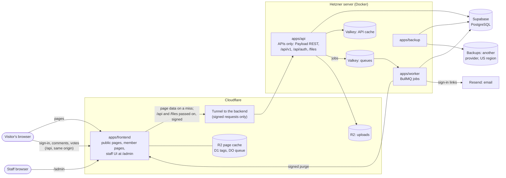

# 0014: Split one frontend, the site and the admin, from an API-only backend

- Date: 2026-10-20
- Status: Proposed

## Context

Today one Next.js app (`apps/web`) does everything a visitor or admin
touches:

- renders the public pages, reading the database directly through Payload's
  local API (`src/public/cached.ts`, `content.ts`);
- runs sign-in (Better Auth, `/api/auth/*`) and the member API (`/api/v1/*`:
  comments, votes, reports, account, notifications, feedback, data export,
  browsing, error reports);
- serves Payload's admin panel (`/admin`) and Payload's REST API (`/api`);
- serves uploaded files (`/files/[id]`);
- puts jobs on the BullMQ queues (email, reference and video checks, link
  archives, search index) and keeps its page cache in Valkey (ADR 0013).

The developer wants both user interfaces, the public site and the admin, in
one frontend app on Cloudflare Workers (decided 2026-10-20). The Hetzner
server would only answer API calls: it renders no HTML and holds the
database, queues, caches, and secrets.

Facts that shape the design:

- **The public pages' data is already plain JSON** (`src/public/types.ts`,
  ADR 0007). It can be served over HTTP unchanged.
- **Staff permissions live in the backend.** Every collection's access rules
  (`verifiedStaffOnly`, `verifiedAdminsOnly` in `src/access.ts`, which
  require a staff role and a recent authenticator check), its validation
  (`refuse()`, the evidence and reference checks before publishing), its
  audit log, and its purges run in Payload's hooks. They apply to Payload's
  REST API exactly as they apply to its admin panel. A new admin frontend
  therefore changes no rule; it only calls the API.
- **Payload's admin panel cannot run apart from Payload.** Its screens are
  server components that use Payload's local API, with the database
  connection in the same process. It cannot be deployed to Workers or
  pointed at a remote API. The admin is therefore rebuilt in the frontend,
  on Payload's REST API.
- **Writes already check their origin** (`isSameOriginWrite`, against
  `SITE_URL`). Browsers keep talking to one origin, the frontend's, so that
  check stays as it is.

Constraints of Cloudflare Workers that matter here:

- **Runtime:** OpenNext's Cloudflare adapter supports Next.js 16. Each
  isolate has 128 MB of memory and a 1-second startup limit. There are no
  long-lived TCP connections to Redis, so ioredis, BullMQ, and the Valkey
  cache handler cannot run there.
- **Cache:** `revalidateTag` works through OpenNext's tag cache. Pages are
  stored in R2, tags in D1 or Durable Objects, and time-based revalidation
  runs through a Durable Object queue.

## Decision

### Shape

| Part                                      | Runs on                                    | Holds                                                                                                 | Address                                                                                                            |
| ----------------------------------------- | ------------------------------------------ | ----------------------------------------------------------------------------------------------------- | ------------------------------------------------------------------------------------------------------------------ |
| `apps/frontend` (new)                     | Cloudflare Workers, one Worker             | The public pages, the member pages, and the staff UI under `/admin`                                   | `https://<domain>`, with the admin at `<domain>/admin`                                                             |
| `apps/api` (today's `apps/web`, renamed)  | Hetzner (Docker)                           | Payload without its admin panel, sign-in, Payload's REST API, `/api/v1`, page data, `/files`. No HTML | None of its own: reached at `<domain>/api/*` and `<domain>/files/*` through the frontend, then a Cloudflare Tunnel |
| `apps/worker`, `apps/backup`              | Hetzner (Docker)                           | Unchanged                                                                                             | Not public                                                                                                         |
| PostgreSQL, two Valkeys, uploads, backups | Supabase / Hetzner / R2 / another provider | Unchanged, except that backups move off R2 (Everything else)                                          | Not public                                                                                                         |

The frontend imports nothing from Payload, `pg`, ioredis, or
`@countrytopics/jobs`, and holds no database, queue, or service credentials.
A lint rule (`no-restricted-imports`) enforces the imports. Its only secrets
are narrow keys:

- the purge key, which checks the worker's purges (Cache and purges);
- the forwarding key, which signs every request it passes to the backend,
  with the visitor's address (Sign-in and API calls);
- a Cloudflare token limited to purging the zone's cache, if phase 1 shows
  OpenNext needs one;
- on staging only, a Cloudflare Access service token for the backend's
  Tunnel host (Environments).

Inside the frontend, the site and the admin are two route groups, each with
its own root layout, so neither loads the other's header, styles, or
scripts:

- `app/(site)/…`: the public pages and the member pages;
- `app/(admin)/admin/…`: the staff UI.



### Repository

```
apps/
  frontend/    Next.js on Workers: the site and the admin, an API client
  api/         Next.js + Payload on Hetzner, APIs only (renamed from apps/web)
  worker/      unchanged
  backup/      unchanged
packages/
  contracts/   new: request and response types and zod schemas for /api/v1 and
               the page data; Payload's generated types for the REST API
  domain, jobs, observability, search, sources, email: unchanged
```

### The backend: APIs only

- **No admin panel.** The `app/(payload)/admin` route group is removed;
  Payload's REST routes (`app/(payload)/api`) stay. Payload keeps its
  collections, hooks, access rules, versions, and uploads.
- **Its paths**, which visitors reach only through the frontend at
  `<domain>`:
  - `/api/<collection>`: Payload's REST API, used by the admin;
  - `/api/v1/*`: the member API, plus the new page-data endpoints;
  - `/api/auth/*`: sign-in;
  - `/files/:id`: uploaded files.
- **It answers only the frontend.** Its Tunnel host (`api.<domain>`,
  `api-dev.<domain>` on staging, one level deep so Cloudflare's free
  certificate covers it) refuses any request without the frontend's
  signature, so it is not a public API. The exceptions are
  `/api/v1/health`, which reveals nothing and is what the containers' and
  Caddy's health checks call, and the rehearsal and load tests, which sign
  their requests with that environment's key.
- **Its links and redirects name the frontend.** Routes that redirect, such
  as the browse and comment routes' canonical redirects, build their URLs
  from `SITE_URL` instead of the request's own address, which is the
  Tunnel host behind the pass-through.
- **The REST API is staff-only for writes**, as now: the access rules
  refuse anyone without a staff role and a recent authenticator check. With
  the admin panel gone, the REST API also gets rate limits for staff writes,
  and `/api/<collection>` reads open to the public only where they are today.
- **The page-data endpoints** replace the site's direct reads, served
  through the existing `cached()` loaders so Valkey still absorbs repeated
  reads:

  | Endpoint                              | Replaces                |
  | ------------------------------------- | ----------------------- |
  | `GET /api/v1/pages/home`              | `homePage()`            |
  | `GET /api/v1/pages/topics/:slug`      | `topicPage()`           |
  | `GET /api/v1/pages/countries/:slug`   | `countryPage()`         |
  | `GET /api/v1/pages/individuals/:slug` | `individualPage()`      |
  | `GET /api/v1/topics`, browse terms    | Already HTTP (ADR 0008) |

  A missing or unpublished item answers 404. File URLs stay as they are
  (`/files/:id`), on the frontend's host.

### The admin

The admin is part of `apps/frontend`, at `/admin`. It rebuilds what staff
use in Payload's admin panel today, on Payload's REST API (`?depth=`,
`?draft=true`, `/versions`, multipart uploads):

- **Sign-in and the authenticator gate**, reusing the account page's
  two-factor flow. The backend's access rules stay the real check.
- **Lists** for the 17 collections Payload's panel shows today (comment
  votes and notifications stay hidden), with search, filters, sorting, and
  pagination, as its list views offer now.
- **The topic editor:**
  - the rich-text body, using Lexical (the editor Payload's rich text is
    built on), saving the same JSON so the site renders it unchanged;
  - internal links to topics and individuals;
  - people, evidence, and references;
  - the workflow: draft, ready for review, publish, archive, with the change
    note;
  - version history and restoring a version.
- **The other editors:** countries, categories, tags, individuals (with
  statements and the possible-duplicates check), references (with the lookup
  by DOI or ISBN), media uploads with licence and credit, snippets (the
  existing snippet editor and preview, moved into the frontend), videos and
  link archives (their check status).
- **Moderation and people:** comments and reports (hide, lock), feedback,
  invitations, users and roles, and the audit log.
- **Errors from the API**, such as a refused publish because a reference is
  unconfirmed, shown beside the field they name, as Payload's panel does.
- **Everything else Payload's panel does today**, because the developer
  decided the pilot's admin must match it in full (2026-10-20):
  - bulk actions on lists (select many, then publish, archive, or delete
    where the access rules allow);
  - autosave of drafts while editing;
  - live preview of a topic as visitors will see it;
  - comparing two versions side by side, and restoring one;
  - document locking, so two editors cannot overwrite each other;
  - duplicating a record;
  - choosing list columns, with filters remembered per staff member;
  - creating a related record without leaving the editor (a new reference
    from a topic, say);
  - image uploads by drag and drop, several at once, with a focal point;
  - a dashboard of recent work and items waiting for review.

How the admin sits in the same app as the site:

- **Never cached.** Every admin screen is rendered per request with the
  staff member's cookie and sent with `Cache-Control: private, no-store`.
- **Gated twice.** The frontend asks the backend for the session before it
  renders anything under `/admin`, and sends anyone without a staff role to
  sign-in. The backend's access rules remain the real check: the admin's
  scripts hold no secret and no permission, so a visitor who downloads them
  gains nothing.
- **Heavy parts load in the browser.** The rich-text editor, drag-and-drop
  uploads, and version comparison are loaded with `next/dynamic` and
  `ssr: false`. They ship as static files, which do not count towards the
  Worker's size limit (10 MB compressed on Workers Paid), and visitors to
  the public pages never download them.
- **One deploy.** A change to the admin redeploys the site too, and the
  reverse. Both are tested together on staging before promotion.

### Sign-in and API calls, through the frontend

Browsers only ever talk to the frontend's host. The frontend passes
`/api/*` and `/files/*` on to the backend, so the session cookie never needs
to cover another host. That is what lets staging live at `dev.<domain>`
(Environments): production's cookie is never sent there.

- **The pass-through:** a route in the frontend forwards each `/api/*` and
  `/files/*` request to the backend's Tunnel host unchanged: method, body
  (streamed), cookies, and response headers, including every `Set-Cookie`.
  It fetches with `redirect: "manual"`, so a redirect, such as the one that
  ends a Google or email sign-in with its cookie, reaches the browser
  instead of being followed in the Worker. As a safeguard, it rewrites any
  `Location` that names the Tunnel host to the frontend's host. The one
  path it does not pass on is `/api/revalidate`, which the frontend answers
  itself (Cache and purges). Uploads fit Cloudflare's request limit (100 MB on
  the Free and Pro plans; the media limit is 20 MB).
- **Every passed-on request is signed.** The frontend adds the visitor's
  address (from Cloudflare's header) and a signature with the forwarding
  key: an HMAC over the method, the path with its query, the address, and
  a timestamp. The body is not signed: the signature proves the request
  came through the frontend, and TLS protects the rest. The backend refuses
  unsigned requests and timestamps more than 5 minutes off its own clock,
  which allows for drift between Cloudflare's and Hetzner's clocks. It
  takes the client address only from a signed request, for Better Auth's
  limits and its own, so rate limits still count each visitor. Locally,
  where no Cloudflare header exists, the frontend signs `127.0.0.1`, so
  local requests share one bucket, as they do today.
- **The frontend's own calls are signed too:** member pages, the `/admin`
  gate, and page data. Its cached page-data reads put the signed fetch
  inside a `"use cache"` function keyed by the path. Next.js puts a fetch's
  headers in its cache key, so a fresh signature on every call would
  otherwise mean the cache never hits.
- **Cookies stay host-only and carry the `__Host-` prefix.** Better Auth's
  cookies are set without a `Domain` attribute, as now, so browsers send
  them only to `<domain>`, never to `dev.<domain>` or any other host. The
  prefix is required, not optional: browsers refuse a `__Host-` cookie
  that names a domain, so staging, which is same-site with production,
  cannot plant a session cookie that production would read. If Better Auth
  cannot name its cookies that way, the pass-through adds the prefix to
  every `Set-Cookie` on the way out and removes it from `Cookie` on the way
  in. Tests check that no response sets a `Domain` attribute and that every
  session cookie has the prefix.
- **No CORS.** Every browser call is same-origin, so `isSameOriginWrite`
  and Payload's `csrf` keep checking against `SITE_URL`, as today.
- **Payload's panel during the move, on staging only.** From phase 4 to
  phase 12, staff still edit staging's content in Payload's panel:
  - Its route (Payload's `routes.admin` and the `app/(payload)/admin`
    folder) moves to `/cms`, and the pass-through forwards `/cms` like
    `/api`.
  - Its scripts and styles would load from `/_next`, which the frontend
    answers itself, so the backend gets `assetPrefix: "/cms-assets"`, which
    the pass-through also forwards.
  - Phase 4 confirms that the panel loads this way. If it does not, staff
    use the panel on staging's Tunnel host, behind Cloudflare Access, until
    phase 12.

  Phase 12 removes the panel, the route, and the prefix. Production starts
  after phase 12, so it never has the panel.

- **Member pages** (account, notifications, feedback, the sign-in redirect)
  are rendered by the frontend per request, sending the visitor's cookie to
  the backend. They are never cached.
- **Callback addresses:** Google's redirect is
  `https://<domain>/api/auth/callback/google`, and email links point at
  `<domain>/api/auth/*`, as today.
- **Staff and members sign in the same way**, on the same pages; staff
  then pass the authenticator check before the admin opens.

### Cache and purges

- **On the site:** OpenNext's small-site setup: an R2 incremental cache, the
  D1 tag cache, and the Durable Object queue. Pages keep `revalidate =
3600`. Their fetches carry the backend's tags (`public-cache.ts`).
- **Purges cross hosts.** `purgePublicPages()` still purges the backend's
  Valkey cache in `after()`, once the change is committed. Only when that
  purge has finished does it queue a `purge` job, so the frontend's next miss
  cannot fetch, and cache for an hour, the old data. The worker sends the
  job to the site as `POST /api/revalidate` with the tags, signed with the
  purge key (HMAC, timestamped, rejected after 5 minutes). The site calls
  `revalidateTag`, and OpenNext purges Cloudflare's cache. A failed purge
  is retried; the hourly revalidation bounds staleness if every retry fails.
- **The Valkey page cache stays** on the backend, now holding API responses.

### Everything else

- **Where data is stored: the US only**, for every member, wherever they
  live (the developer, 2026-10-20; ADR 0012 already put Sentry there):
  - the Hetzner server in Ashburn, Virginia, and the Supabase project in
    East US (North Virginia), close together so database calls stay short;
  - R2 buckets and the D1 database created with Cloudflare's eastern North
    America location hint (`enam`), which Cloudflare follows on a
    best-effort basis; they hold staff uploads and cached public pages;
  - backups on another provider's US storage, not R2, so that one account
    or outage cannot take the uploads and every backup together, as ADR
    0012 requires (the provider is chosen in phase 13);
  - Resend sending from its US region, and Sentry's US region, as now.

  Cloudflare's edge, outside the US too, may hold copies of responses that
  carry only published content: public pages and staff uploads. Nothing
  with members' data is stored there:
  - member pages and the admin are never cached;
  - the comment lists keep their short browser and Valkey caching but send
    `Cloudflare-CDN-Cache-Control: no-store`, so Cloudflare does not store
    members' names and comments.

  Staging uses the same regions. The privacy policy says that all data is
  stored in the US.

- **Error reporting:** each app reports its own errors. The frontend uses
  Sentry's Cloudflare SDK with the scrubbing from
  `@countrytopics/observability`. Browser reports still go through the
  backend's `/api/v1/errors`.
- **Turnstile:** the widget is on the site; the backend checks the token.
- **Design:** the site and the admin share the tokens and fonts from PR
  #18, in the frontend. PR #18 is merged before phase 5, whose checks
  compare against its screenshots.
- **Local development:** see Environments below.

### Environments

The developer decided (2026-10-20) that development and production are kept
apart, and that every environment has the split's shape from the first
phase, so that nothing first meets the pass-through, its signatures, or
the Workers runtime in production.

There are three environments on one domain: production at `<domain>` and
staging at `dev.<domain>` (decided 2026-10-21). Each environment has the
same two apps reached the same way; they share code, never data, secrets,
or cookies.

| Service           | Local (each developer's machine)                                                              | Staging (hosted, for testing)                                                        | Production                                                             |
| ----------------- | --------------------------------------------------------------------------------------------- | ------------------------------------------------------------------------------------ | ---------------------------------------------------------------------- |
| Addresses         | `localhost:3000`, `/admin`; the backend on `localhost:3001`, reached through the pass-through | `dev.<domain>`, `dev.<domain>/admin`; the backend's Tunnel host `api-dev.<domain>`   | `<domain>`, `<domain>/admin`; the backend's Tunnel host `api.<domain>` |
| Frontend          | `next dev`                                                                                    | Its own Worker (`frontend-staging`), R2 bucket, and D1 database                      | Its own Worker, R2 bucket, and D1 database                             |
| Backend           | Docker Compose                                                                                | Its own small Hetzner server and Tunnel                                              | Its own Hetzner server and Tunnel                                      |
| Database          | PostgreSQL 17 in Docker                                                                       | Its own Supabase project, in a separate Supabase organisation                        | Its own Supabase project                                               |
| Email             | Mailpit; nothing leaves the machine                                                           | Resend, sending from `dev.<domain>` with its own API key; sends only to an allowlist | Resend, the production domain and key                                  |
| Sign-in providers | Google's and Turnstile's test settings                                                        | Their own Google client and Turnstile widget                                         | Their own Google client and Turnstile widget                           |
| Error reports     | Off                                                                                           | Sentry, `environment: staging`                                                       | Sentry, `environment: production`                                      |
| Backups           | None                                                                                          | Its own bucket on the backup provider                                                | Its own bucket on the backup provider                                  |
| Secrets           | `.env` (never committed)                                                                      | GitHub environment `staging`                                                         | GitHub environment `production`, with an approval                      |
| Data              | Synthetic                                                                                     | Synthetic only                                                                       | Real; never copied to another environment                              |
| Who can open it   | The developer                                                                                 | Staff and named testers, through Cloudflare Access on `dev.<domain>`                 | Invited testers during the pilot                                       |

Rules that keep them apart:

- **Production's cookies never reach staging.** They are host-only on
  `<domain>` (Sign-in and API calls), so browsers do not send them to
  `dev.<domain>`, and staging's are host-only on `dev.<domain>`. Nothing in
  either environment sets a cookie for the whole domain.
- **Every app knows its environment.** `APP_ENV` (`local`, `staging`, or
  `production`) is required, and each app refuses to start when an address
  belongs to another environment: production with a `localhost` or staging
  address, staging with production's domain, local with anything public.
  Hostnames are compared exactly, never by suffix, since `dev.<domain>`
  ends with production's domain.
  This extends the check in `src/env.ts` that refuses Turnstile's test keys
  outside `localhost`.
- **Staging is closed to the public from phase 0.** Cloudflare Access
  covers `dev.<domain>`, except `/api/revalidate`, which checks its own
  signature. It also covers the backend's Tunnel host, `api-dev.<domain>`,
  so the staging backend is closed before phase 4 adds the signatures.
  The staging frontend passes Access with a service token that exists only
  in staging. Production's backend opens in phase 13, after the signatures
  exist, and has no Access.
- **One build, promoted.** A merge to `main` builds the two apps once and
  deploys them to staging, after the database migrations run there. The same
  build reaches production only through a manual promotion with the
  `production` environment's approval, which runs production's migrations
  first. Payload's schema push stays off everywhere (`push: false`).
- **Nothing flows down.** Production data is never restored into staging or
  a laptop; the restore drill restores into a new production-side database,
  as now (ADR 0012). Staging's data is made by the seed scripts and the
  rehearsal.
- **Separate credentials.** Each environment's database password, Better
  Auth secret, purge key, forwarding key, and service keys are its own, so
  staging's keys can never sign a request that production's backend
  accepts, and the
  Cloudflare deploy token for staging cannot touch production's Worker.
- **Local runs the same pass-through.** `next dev` serves the frontend on
  `localhost:3000` and passes `/api` and `/files` to the backend on
  `localhost:3001` with the same signed route, so sign-in, cookies, and
  redirects behave as in production.

Staging costs about $10–30 a month (a small Hetzner server and Supabase's
free plan in its own organisation); it needs no domain of its own.
Cloudflare, Sentry, and Resend use the same accounts as production.

#### Before the domain is bought

The developer has no domain yet (2026-10-21). Only production (phase 13)
and staging's real email need one, so phases 0–12 run without it. Because
browsers only ever talk to the frontend, staging works on temporary
addresses:

- **The frontend** runs at Cloudflare's free address,
  `frontend-staging.<account>.workers.dev`, with Cloudflare Access turned
  on for it. `workers.dev` is on the Public Suffix List, so no other
  `workers.dev` site can read or set its cookies; phase 0 checks this.
- **The backend** cannot have a Tunnel hostname without a domain on
  Cloudflare. Until then, Caddy on the staging server serves it over HTTPS,
  with a Let's Encrypt certificate, at a hostname from a wildcard DNS
  service that names the server's address (such as `<address>.sslip.io`).
  The server's firewall admits only Cloudflare's published address ranges.
  From phase 0 the backend refuses any request without the staging
  frontend's key: a shared key at first, which phase 4 replaces with the
  signature.
- **Email** goes to Mailpit on the staging server, reached only over SSH,
  so no email leaves staging. Staff read staging's sign-in links there, and
  named testers sign in with Google.

Once the domain is bought, phase 13 moves staging to `dev.<domain>`, with
its Tunnel at `api-dev.<domain>` and Resend sending from `dev.<domain>`, at
the same time as it sets up production.

## Plan

Each phase ends with its checks passing and is a PR of its own, as AGENTS.md
asks. Estimates are working days for one developer with Claude. The two
spikes are go/no-go gates: if one fails, stop and revisit this decision.
Everything from phase 1 on is deployed to staging as it is built.

| Phase                       | Work                                                                                                                                                                                                                                                                                              | Done when                                                                                                                                                                                                                                   | Days                          |
| --------------------------- | ------------------------------------------------------------------------------------------------------------------------------------------------------------------------------------------------------------------------------------------------------------------------------------------------- | ------------------------------------------------------------------------------------------------------------------------------------------------------------------------------------------------------------------------------------------- | ----------------------------- |
| 0. Environments             | Staging on its temporary addresses (Before the domain is bought): its Worker on `workers.dev`, R2, D1, Supabase project, Hetzner server with Caddy and Mailpit, the firewall, the backend's key, and Cloudflare Access; GitHub environments; `APP_ENV` and the start-up checks                    | A placeholder page and a health check deploy to staging from `main`; each app refuses another environment's addresses                                                                                                                       | 3–4                           |
| 1. Site spike               | A throwaway OpenNext build of the topic page on staging                                                                                                                                                                                                                                           | The page renders its rich text, fits Workers' limits, `revalidateTag` purges it, fonts load, Sentry reports                                                                                                                                 | 2–3                           |
| 2. Admin spike              | A throwaway `/admin` page in the same build that edits one topic through the REST API: the Lexical body, one relation, saving a draft, publishing                                                                                                                                                 | The saved JSON renders unchanged on the site; the Worker with the admin in it still fits; public pages load none of the admin's scripts; a refused publish shows its error                                                                  | 3–4                           |
| 3. Contracts and page data  | `packages/contracts`; the four `/api/v1/pages/*` endpoints; integration tests                                                                                                                                                                                                                     | Each endpoint returns exactly what the page builds today; drafts and archived items answer as the pages do                                                                                                                                  | 3–4                           |
| 4. API through the frontend | The pass-through for `/api`, `/files`, and staging's `/cms` with its assets; request signatures and the visitor's address; redirects built from `SITE_URL`; `__Host-` cookies; staff write limits; `/security-guidance` review                                                                    | Sign-in, comments, votes, reports, account deletion, export, and a staff edit work at `<domain>`; an unsigned request to the backend is refused; sign-in's redirects keep their cookies; every session cookie is `__Host-` with no `Domain` | 3–4                           |
| 5. `apps/frontend`          | Move the public pages and components; the API client; member pages with the forwarded cookie; the admin route group and its gate                                                                                                                                                                  | Every page matches PR #18's screenshots and passes the whole-site audit                                                                                                                                                                     | 5–7                           |
| 6. Purges                   | The `purge` job, `POST /api/revalidate`, signature checks                                                                                                                                                                                                                                         | Publishing changes the site within seconds; a forged or old purge is refused; a failed one retries                                                                                                                                          | 2                             |
| 7. Admin shell and lists    | Sign-in and the authenticator gate, navigation, list views for the 17 collections                                                                                                                                                                                                                 | Staff can find any record as fast as in Payload's panel                                                                                                                                                                                     | 5–7                           |
| 8. Topic editor             | Body, links, people, evidence, references, workflow, change notes, versions, field errors                                                                                                                                                                                                         | An editor publishes a real topic end to end; every refusal Payload's panel showed is shown                                                                                                                                                  | 8–12                          |
| 9. Other editors            | Countries, categories, tags, individuals, references, media, snippets, videos, link archives                                                                                                                                                                                                      | Each record type can be created, edited, and checked as today                                                                                                                                                                               | 6–9                           |
| 10. Moderation and people   | Comments, reports, feedback, invitations, users and roles, audit log                                                                                                                                                                                                                              | The moderation manual tests from weeks 9 and 10 pass in the new admin                                                                                                                                                                       | 4–6                           |
| 11. Admin parity            | Bulk actions, autosave, live preview, version comparison, document locking, duplicating, list columns and remembered filters, inline creation of related records, multi-file uploads with a focal point, the dashboard                                                                            | Every feature staff use in Payload's panel today has its counterpart; Payload's panel can be removed without loss                                                                                                                           | 10–15                         |
| 12. Backend clean-up        | Remove Payload's admin panel (`/cms`, its assets prefix) and the public pages from the backend; rename `apps/web` to `apps/api`; update AGENTS.md and the docs that ADR 0014 supersedes                                                                                                           | The backend answers no HTML; the import lint rules pass                                                                                                                                                                                     | 2–3                           |
| 13. Production              | The domain bought; production's Worker, R2, D1, Supabase project, Hetzner server, and Tunnel; staging moved to `dev.<domain>` with its Tunnel and Resend; the backup provider's US bucket; the promotion workflow; Compose, the rehearsal, and runbooks, including the ownership-transfer runbook | A build promoted from staging serves production, with production's migrations run first; staging serves `dev.<domain>`                                                                                                                      | 3–4                           |
| 14. Verification            | Load test through Workers and the Tunnel; `make scale-check`; restore drill; every manual test so far, in the new admin                                                                                                                                                                           | 500 simultaneous visitors with no failures and a 95th percentile under 500 ms for uncached pages                                                                                                                                            | 3–4                           |
| **Total**                   |                                                                                                                                                                                                                                                                                                   |                                                                                                                                                                                                                                             | **62–88 (about 12–18 weeks)** |

About 60% of the time (phases 2 and 7–11) is the admin frontend.

The pilot runs on the split, after phase 14: the developer decided
(2026-10-20) to have the split from the beginning rather than run the pilot
on today's single app.

## Consequences

**Gains:**

- Both user interfaces run on Cloudflare's edge, in one app. The public
  site keeps serving cached pages while the backend is busy or briefly down.
- The server renders no HTML; its surface is the API, which is easier to
  reason about, test, and reuse (a mobile app could use the same API).
- The frontend holds no database credentials or queue access.
- The admin can be designed for this project's work (topics with evidence)
  rather than Payload's generic screens.

**Costs:**

- **The admin is rebuilt.** Payload's panel gives today, for free, what
  phases 7–11 rebuild. Every future collection or field means admin work
  too, where Payload's panel showed it automatically, and Payload's own
  admin improvements no longer arrive with upgrades.
- **Two apps** to build, deploy, and keep compatible. API changes must be
  additive: deploy the backend first, then the frontend.
- **The site and the admin deploy together**, so a broken admin change
  holds back a site fix until it is reverted, and the reverse.
- **An extra network hop:** every uncached page, every member page, and
  every admin screen waits for a call from Cloudflare to Hetzner, kept to
  one call per screen. Browser API calls pass through the Worker, which
  costs little time, since they would cross Cloudflare anyway, but counts
  each one as a Worker request. Cloudflare's Smart Placement would run the Worker
  near Virginia, beside the backend and R2, which shortens that call but
  makes far-away visitors wait for one long round trip on every page,
  cached or not; static files still come from the nearest data centre.
  Phase 1 measures both settings, and the faster one for the expected
  visitors is kept.
- **New surface to get right and test:** the pass-through, its request
  signatures, and signed purges.
- **Running cost:** Workers Paid ($5 a month plus usage) and small R2, D1,
  and Durable Object charges. The Hetzner server may shrink one size.
- **Time:** about 12–18 weeks before the pilot can run, on the new shape.
- **A staging environment** to run and pay for (about $10–30 a month).

**Unchanged:** the data model, the access rules, the hooks, the worker and
its jobs, backups, invite-only sign-in, and `noindex`.

**Supersedes, once accepted:**

- ADR 0001's one deployable web app (`apps/web` with the site, Payload's
  admin panel, and `/api/v1`);
- the parts of ADR 0007 and ADR 0013 that describe the public pages'
  caching;
- ADR 0002's use of Payload's admin panel for staff;
- ADR 0012's backups on R2, now that uploads are there too;
- in AGENTS.md, the directory boundaries for `apps/web`, "everything runs
  in containers" (the frontend runs on a Worker), and the shared page cache
  in Redis (pages are cached in R2 and D1). Phase 12 updates AGENTS.md.

Their other decisions stand.

## Alternatives considered

- **Keep Payload's admin panel on the backend** (this ADR's first draft): the
  split without phases 2 and 7–11, 25–34 days or about 5–7 weeks. The
  backend then renders the admin's HTML, which the developer did not want.
- **The admin as a separate app** (`apps/admin`, a second Worker at
  `<domain>/admin`; this ADR's second draft): separate deploys and a smaller
  site Worker, at the cost of a third app, a Workers route, `basePath`, and
  a shared `packages/ui`. The developer chose one app.
- **The backend at its own address, `api.<domain>`, called by browsers**
  (this ADR's third draft): it needs CORS and a session cookie for the
  whole domain, which browsers would also send to `dev.<domain>`. Staging
  would then need a domain of its own.
- **Payload's admin panel in its own container on Hetzner:** the API
  container would render no HTML, and the admin would still be Payload's,
  about one week on top of that draft. It still needs the database and
  queues, so it is a second backend, not a frontend on Cloudflare.

## Open questions for the developer

1. **The domain's name.** Production uses `<domain>` and staging
   `dev.<domain>`. It is needed by phase 13; until then staging runs on
   temporary addresses (Before the domain is bought).
