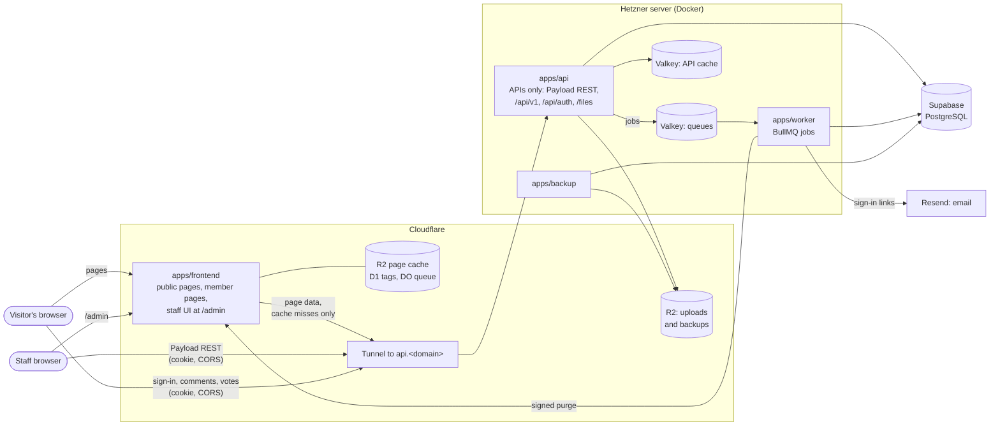

# 0014: Split one frontend, the site and the admin, from an API-only backend

- Date: 2026-10-20
- Status: Proposed

## Context

Today one Next.js app (`apps/web`) does everything a visitor or admin
touches:

- renders the public pages, reading the database directly through Payload's
  local API (`src/public/cached.ts`, `content.ts`);
- runs sign-in (Better Auth, `/api/auth/*`) and the member API (`/api/v1/*`:
  comments, votes, reports, account, notifications, feedback, data export,
  browsing, error reports);
- serves Payload's admin panel (`/admin`) and Payload's REST API (`/api`);
- serves uploaded files (`/files/[id]`);
- puts jobs on the BullMQ queues (email, reference and video checks, link
  archives, search index) and keeps its page cache in Valkey (ADR 0013).

The developer wants both user interfaces, the public site and the admin, in
one frontend app on Cloudflare Workers (decided 2026-10-20). The Hetzner server would only answer API
calls: it renders no HTML and holds the database, queues, caches, and
secrets.

Facts that shape the design:

- **The public pages' data is already plain JSON** (`src/public/types.ts`,
  ADR 0007). It can be served over HTTP unchanged.
- **Staff permissions live in the backend.** Every collection's access rules
  (`verifiedStaffOnly`, `verifiedAdminsOnly` in `src/access.ts`, which
  require a staff role and a recent authenticator check), its validation
  (`refuse()`, the evidence and reference checks before publishing), its
  audit log, and its purges run in Payload's hooks. They apply to Payload's
  REST API exactly as they apply to its admin panel. A new admin frontend
  therefore changes no rule; it only calls the API.
- **Payload's admin panel cannot run apart from Payload.** Its screens are
  server components that use Payload's local API, with the database
  connection in the same process. It cannot be deployed to Workers or
  pointed at a remote API. The admin is therefore rebuilt in the frontend,
  on Payload's REST API.
- **Writes already check their origin** (`isSameOriginWrite`, against
  `SITE_URL`). They must check against the frontend's origin instead.

Constraints of Cloudflare Workers that matter here:

- **Runtime:** OpenNext's Cloudflare adapter supports Next.js 16. Each
  isolate has 128 MB of memory and a 1-second startup limit. There are no
  long-lived TCP connections to Redis, so ioredis, BullMQ, and the Valkey
  cache handler cannot run there.
- **Cache:** `revalidateTag` works through OpenNext's tag cache. Pages are
  stored in R2, tags in D1 or Durable Objects, and time-based revalidation
  runs through a Durable Object queue.

## Decision

### Shape

| Part                                     | Runs on                        | Holds                                                                                                 | Address                                                |
| ---------------------------------------- | ------------------------------ | ----------------------------------------------------------------------------------------------------- | ------------------------------------------------------ |
| `apps/frontend` (new)                    | Cloudflare Workers, one Worker | The public pages, the member pages, and the staff UI under `/admin`                                   | `https://<domain>`, with the admin at `<domain>/admin` |
| `apps/api` (today's `apps/web`, renamed) | Hetzner (Docker)               | Payload without its admin panel, sign-in, Payload's REST API, `/api/v1`, page data, `/files`. No HTML | `https://api.<domain>`, through a Cloudflare Tunnel    |
| `apps/worker`, `apps/backup`             | Hetzner (Docker)               | Unchanged                                                                                             | Not public                                             |
| PostgreSQL, two Valkeys, S3 storage      | Supabase / Hetzner / R2        | Unchanged                                                                                             | Not public                                             |

The frontend imports nothing from Payload, `pg`, ioredis, or
`@countrytopics/jobs`, and holds no secret except the purge key. A lint rule
(`no-restricted-imports`) enforces it.

Inside the frontend, the site and the admin are two route groups, each with
its own root layout, so neither loads the other's header, styles, or
scripts:

- `app/(site)/…`: the public pages and the member pages;
- `app/(admin)/admin/…`: the staff UI.



### Repository

```
apps/
  frontend/    Next.js on Workers: the site and the admin, an API client
  api/         Next.js + Payload on Hetzner, APIs only (renamed from apps/web)
  worker/      unchanged
  backup/      unchanged
packages/
  contracts/   new: request and response types and zod schemas for /api/v1 and
               the page data; Payload's generated types for the REST API
  domain, jobs, observability, search, sources, email: unchanged
```

### The backend: APIs only

- **No admin panel.** The `app/(payload)/admin` route group is removed;
  Payload's REST routes (`app/(payload)/api`) stay. Payload keeps its
  collections, hooks, access rules, versions, and uploads.
- **Its addresses:**
  - `api.<domain>/api/<collection>`: Payload's REST API, used by the admin;
  - `api.<domain>/api/v1/*`: the member API, plus the new page-data
    endpoints;
  - `api.<domain>/api/auth/*`: sign-in;
  - `api.<domain>/files/:id`: uploaded files.
- **The REST API is staff-only for writes**, as now: the access rules
  refuse anyone without a staff role and a recent authenticator check. With
  the admin panel gone, the REST API also gets rate limits for staff writes,
  and `/api/<collection>` reads open to the public only where they are today.
- **The page-data endpoints** replace the site's direct reads, served
  through the existing `cached()` loaders so Valkey still absorbs repeated
  reads:

  | Endpoint                              | Replaces                |
  | ------------------------------------- | ----------------------- |
  | `GET /api/v1/pages/home`              | `homePage()`            |
  | `GET /api/v1/pages/topics/:slug`      | `topicPage()`           |
  | `GET /api/v1/pages/countries/:slug`   | `countryPage()`         |
  | `GET /api/v1/pages/individuals/:slug` | `individualPage()`      |
  | `GET /api/v1/topics`, browse terms    | Already HTTP (ADR 0008) |

  A missing or unpublished item answers 404. File URLs become absolute
  (`https://api.<domain>/files/:id`).

### The admin

The admin is part of `apps/frontend`, at `/admin`. It rebuilds what staff
use in Payload's admin panel today, on Payload's REST API (`?depth=`,
`?draft=true`, `/versions`, multipart uploads):

- **Sign-in and the authenticator gate**, reusing the account page's
  two-factor flow. The backend's access rules stay the real check.
- **Lists** for each of the 19 collections, with search, filters, sorting,
  and pagination, as Payload's list views offer now.
- **The topic editor:**
  - the rich-text body, using Lexical (the editor Payload's rich text is
    built on), saving the same JSON so the site renders it unchanged;
  - internal links to topics and individuals;
  - people, evidence, and references;
  - the workflow: draft, ready for review, publish, archive, with the change
    note;
  - version history and restoring a version.
- **The other editors:** countries, categories, tags, individuals (with
  statements and the possible-duplicates check), references (with the lookup
  by DOI or ISBN), media uploads with licence and credit, snippets (the
  existing snippet editor and preview, moved into the frontend), videos and
  link archives (their check status).
- **Moderation and people:** comments and reports (hide, lock), feedback,
  invitations, users and roles, and the audit log.
- **Errors from the API**, such as a refused publish because a reference is
  unconfirmed, shown beside the field they name, as Payload's panel does.
- **Everything else Payload's panel does today**, because the developer
  decided the pilot's admin must match it in full (2026-10-20):
  - bulk actions on lists (select many, then publish, archive, or delete
    where the access rules allow);
  - autosave of drafts while editing;
  - live preview of a topic as visitors will see it;
  - comparing two versions side by side, and restoring one;
  - document locking, so two editors cannot overwrite each other;
  - duplicating a record;
  - choosing list columns, with filters remembered per staff member;
  - creating a related record without leaving the editor (a new reference
    from a topic, say);
  - image uploads by drag and drop, several at once, with a focal point;
  - a dashboard of recent work and items waiting for review.

How the admin sits in the same app as the site:

- **Never cached.** Every admin screen is rendered per request with the
  staff member's cookie and sent with `Cache-Control: private, no-store`.
- **Gated twice.** The frontend asks the backend for the session before it
  renders anything under `/admin`, and sends anyone without a staff role to
  sign-in. The backend's access rules remain the real check: the admin's
  scripts hold no secret and no permission, so a visitor who downloads them
  gains nothing.
- **Heavy parts load in the browser.** The rich-text editor, drag-and-drop
  uploads, and version comparison are loaded with `next/dynamic` and
  `ssr: false`. They ship as static files, which do not count towards the
  Worker's size limit (10 MB compressed on Workers Paid), and visitors to
  the public pages never download them.
- **One deploy.** A change to the admin redeploys the site too, and the
  reverse. Both are tested together on staging before promotion.

### Sign-in across hosts

The frontend and the backend are two hosts under one registrable domain,
`<domain>` and `api.<domain>`, so browsers treat them as the same site.
Sign-in stays on the backend:

- **Cookies:** Better Auth's
  `advanced.crossSubDomainCookies: { enabled: true, domain: "<domain>" }`
  makes the session cookie readable on `<domain>` and `api.<domain>`.
  `trustedOrigins` lists `https://<domain>`, and sign-in callbacks may
  return to it.
- **CORS on the backend:** for `/api/auth/*`, `/api/v1/*`, and
  `/api/<collection>`, allow exactly `https://<domain>`, with credentials.
  Preflights are answered. `isSameOriginWrite` checks writes against an
  allowlist (`SITE_ORIGINS`) instead of `SITE_URL`. Payload's own `cors`
  and `csrf` settings list the same origin.
- **Browser calls go straight to the backend**, with
  `credentials: "include"`. So the client address comes from Cloudflare's
  header, and rate limits are unchanged.
- **Member pages** (account, notifications, feedback, the sign-in redirect)
  are rendered by the site per request, sending the visitor's cookie to the
  backend. They are never cached.
- **Callback addresses:** Google's redirect becomes
  `https://api.<domain>/api/auth/callback/google`. Email links point at the
  backend, which sets the cookie and redirects to the frontend.
- **Staff and members sign in the same way**, on the same pages; staff
  then pass the authenticator check before the admin opens.

### Cache and purges

- **On the site:** OpenNext's small-site setup: an R2 incremental cache, the
  D1 tag cache, and the Durable Object queue. Pages keep `revalidate =
3600`. Their fetches carry the backend's tags (`public-cache.ts`).
- **Purges cross hosts.** `purgePublicPages()` still purges the backend's
  Valkey cache. It also queues a `purge` job, which the worker sends to the
  site as `POST /api/revalidate` with the tags, signed with a shared secret
  (HMAC, timestamped, rejected after 5 minutes). The site calls
  `revalidateTag`, and OpenNext purges Cloudflare's cache. A failed purge
  is retried; the hourly revalidation bounds staleness if every retry fails.
- **The Valkey page cache stays** on the backend, now holding API responses.

### Everything else

- **Where data is stored: the US only**, for every member, wherever they
  live (the developer, 2026-10-20; ADR 0012 already put Sentry there):
  - the Hetzner server in Ashburn, Virginia, and the Supabase project in
    East US (North Virginia), close together so database calls stay short;
  - R2 buckets and the D1 database created with Cloudflare's eastern North
    America location hint (`enam`), which Cloudflare follows on a
    best-effort basis; they hold uploads, backups, and cached public pages,
    and the backups are personal data;
  - Resend sending from its US region, and Sentry's US region, as now.

  Cloudflare serves pages from the data centre nearest each visitor, but
  stores nothing personal there: member pages and the admin are never
  cached. Staging uses the same regions. The privacy policy says that all
  data is stored in the US.

- **Error reporting:** each app reports its own errors. The frontend uses
  Sentry's Cloudflare SDK with the scrubbing from
  `@countrytopics/observability`. Browser reports still go through the
  backend's `/api/v1/errors`.
- **Turnstile:** the widget is on the site; the backend checks the token.
- **Design:** the site and the admin share the tokens and fonts from PR
  #18, in the frontend.
- **Local development:** see Environments below.

### Environments

The developer decided (2026-10-20) that development and production are kept
apart, and that every environment has the split's shape from the first
phase, so that nothing first meets two hosts, cross-host cookies, or CORS
in production.

There are three environments, and two domains: production's and staging's.
Each environment has the same two apps on the same kind of addresses; they share code, never data, accounts' secrets, or cookies.

| Service           | Local (each developer's machine)                            | Staging (hosted, for testing)                                                       | Production                                        |
| ----------------- | ----------------------------------------------------------- | ----------------------------------------------------------------------------------- | ------------------------------------------------- |
| Addresses         | `ctp.localhost`, `ctp.localhost/admin`, `api.ctp.localhost` | A separate registrable domain: `<staging-domain>`, `/admin`, `api.<staging-domain>` | `<domain>`, `<domain>/admin`, `api.<domain>`      |
| Frontend          | `next dev`                                                  | Its own Worker (`frontend-staging`), R2 bucket, and D1 database                     | Its own Worker, R2 bucket, and D1 database        |
| Backend           | Docker Compose                                              | Its own small Hetzner server and Tunnel                                             | Its own Hetzner server and Tunnel                 |
| Database          | PostgreSQL 17 in Docker                                     | Its own Supabase project, in a separate Supabase organisation                       | Its own Supabase project                          |
| Email             | Mailpit; nothing leaves the machine                         | Resend, its own sending domain and API key; sends only to an allowlist              | Resend, the production domain and key             |
| Sign-in providers | Google's and Turnstile's test settings                      | Their own Google client and Turnstile widget                                        | Their own Google client and Turnstile widget      |
| Error reports     | Off                                                         | Sentry, `environment: staging`                                                      | Sentry, `environment: production`                 |
| Backups           | None                                                        | Its own bucket                                                                      | Its own bucket                                    |
| Secrets           | `.env` (never committed)                                    | GitHub environment `staging`                                                        | GitHub environment `production`, with an approval |
| Data              | Synthetic                                                   | Synthetic only                                                                      | Real; never copied to another environment         |
| Who can open it   | The developer                                               | Behind Cloudflare Access (staff and named testers)                                  | Invited testers during the pilot                  |

Rules that keep them apart:

- **Staging has its own domain, not a subdomain of production's.**
  Production's session cookie is set for `<domain>` and every host under it
  (Sign-in across hosts), so a `staging.<domain>` would receive production
  sessions. A separate domain cannot.
- **Every app knows its environment.** `APP_ENV` (`local`, `staging`, or
  `production`) is required, and each app refuses to start when an address
  belongs to another environment: production with a `localhost` or staging
  address, staging with production's domain, local with anything public.
  This extends the check in `src/env.ts` that refuses Turnstile's test keys
  outside `localhost`.
- **One build, promoted.** A merge to `main` builds the two apps once and
  deploys them to staging, after the database migrations run there. The same
  build reaches production only through a manual promotion with the
  `production` environment's approval, which runs production's migrations
  first. Payload's schema push stays off everywhere (`push: false`).
- **Nothing flows down.** Production data is never restored into staging or
  a laptop; the restore drill restores into a new production-side database,
  as now (ADR 0012). Staging's data is made by the seed scripts and the
  rehearsal.
- **Separate credentials.** Each environment's database password, Better
  Auth secret, purge-signing key, and service keys are its own, and the
  Cloudflare deploy token for staging cannot touch production's Worker.
- **Local mirrors the hosts.** Browsers send `*.localhost` to the developer's
  own machine, so local sign-in uses a cookie for `ctp.localhost` across
  `ctp.localhost` and `api.ctp.localhost`, and CORS runs as in production.
  Phase 0 checks that browsers accept that cookie; if not, local uses
  hosts-file names under a test domain with a local certificate.

Staging costs about $10–30 a month (a small Hetzner server, Supabase's free
plan in its own organisation, and the staging domain); Cloudflare, Sentry,
and Resend use the same accounts as production.

## Plan

Each phase ends with its checks passing and is a PR of its own, as AGENTS.md
asks. Estimates are working days for one developer with Claude. The two
spikes are go/no-go gates: if one fails, stop and revisit this decision.
Everything from phase 1 on is deployed to staging as it is built.

| Phase                      | Work                                                                                                                                                                                                                   | Done when                                                                                                                                                                  | Days                          |
| -------------------------- | ---------------------------------------------------------------------------------------------------------------------------------------------------------------------------------------------------------------------- | -------------------------------------------------------------------------------------------------------------------------------------------------------------------------- | ----------------------------- |
| 0. Environments            | The staging domain, its Workers, R2, D1, Supabase project, Hetzner server, Tunnel, and Cloudflare Access; GitHub environments; `APP_ENV` and the start-up checks; local `*.localhost` addresses                        | A placeholder page and a health check deploy to staging from `main`; each app refuses another environment's addresses                                                      | 3–4                           |
| 1. Site spike              | A throwaway OpenNext build of the topic page on staging                                                                                                                                                                | The page renders its rich text, fits Workers' limits, `revalidateTag` purges it, fonts load, Sentry reports                                                                | 2–3                           |
| 2. Admin spike             | A throwaway `/admin` page in the same build that edits one topic through the REST API: the Lexical body, one relation, saving a draft, publishing                                                                      | The saved JSON renders unchanged on the site; the Worker with the admin in it still fits; public pages load none of the admin's scripts; a refused publish shows its error | 3–4                           |
| 3. Contracts and page data | `packages/contracts`; the four `/api/v1/pages/*` endpoints; integration tests                                                                                                                                          | Each endpoint returns exactly what the page builds today; drafts and archived items answer as the pages do                                                                 | 3–4                           |
| 4. Sign-in across hosts    | Cross-subdomain cookies, CORS for all three API groups, the origin allowlist, Payload's `cors` and `csrf`, staff write limits; `/security-guidance` review                                                             | Sign-in, comments, votes, reports, account deletion, export, and a staff edit work from `<domain>`; another origin is refused                                              | 3–4                           |
| 5. `apps/frontend`         | Move the public pages and components; the API client; member pages with the forwarded cookie; the admin route group and its gate                                                                                       | Every page matches PR #18's screenshots and passes the whole-site audit                                                                                                    | 5–7                           |
| 6. Purges                  | The `purge` job, `POST /api/revalidate`, signature checks                                                                                                                                                              | Publishing changes the site within seconds; a forged or old purge is refused; a failed one retries                                                                         | 2                             |
| 7. Admin shell and lists   | Sign-in and the authenticator gate, navigation, list views for the 19 collections                                                                                                                                      | Staff can find any record as fast as in Payload's panel                                                                                                                    | 5–7                           |
| 8. Topic editor            | Body, links, people, evidence, references, workflow, change notes, versions, field errors                                                                                                                              | An editor publishes a real topic end to end; every refusal Payload's panel showed is shown                                                                                 | 8–12                          |
| 9. Other editors           | Countries, categories, tags, individuals, references, media, snippets, videos, link archives                                                                                                                           | Each record type can be created, edited, and checked as today                                                                                                              | 6–9                           |
| 10. Moderation and people  | Comments, reports, feedback, invitations, users and roles, audit log                                                                                                                                                   | The moderation manual tests from weeks 9 and 10 pass in the new admin                                                                                                      | 4–6                           |
| 11. Admin parity           | Bulk actions, autosave, live preview, version comparison, document locking, duplicating, list columns and remembered filters, inline creation of related records, multi-file uploads with a focal point, the dashboard | Every feature staff use in Payload's panel today has its counterpart; Payload's panel can be removed without loss                                                          | 10–15                         |
| 12. Backend clean-up       | Remove Payload's admin panel and the public pages from the backend; rename `apps/web` to `apps/api`                                                                                                                    | The backend answers no HTML; the import lint rules pass                                                                                                                    | 2–3                           |
| 13. Production             | Production's Worker, R2, D1, Supabase project, Hetzner server, and Tunnel; the promotion workflow; Compose, the rehearsal, and runbooks, including the ownership-transfer runbook                                      | A build promoted from staging serves production, with production's migrations run first                                                                                    | 2–3                           |
| 14. Verification           | Load test through Workers and the Tunnel; `make scale-check`; restore drill; every manual test so far, in the new admin                                                                                                | 500 simultaneous visitors with no failures and a 95th percentile under 500 ms for uncached pages                                                                           | 3–4                           |
| **Total**                  |                                                                                                                                                                                                                        |                                                                                                                                                                            | **61–87 (about 12–18 weeks)** |

About 60% of the time (phases 2 and 7–11) is the admin frontend.

The pilot runs on the split, after phase 14: the developer decided
(2026-10-20) to have the split from the beginning rather than run the pilot
on today's single app.

## Consequences

**Gains:**

- Both user interfaces run on Cloudflare's edge, in one app. The public site keeps
  serving cached pages while the backend is busy or briefly down.
- The server renders no HTML; its surface is the API, which is easier to
  reason about, test, and reuse (a mobile app could use the same API).
- The frontend holds no database credentials or queue access.
- The admin can be designed for this project's work (topics with evidence)
  rather than Payload's generic screens.

**Costs:**

- **The admin is rebuilt.** Payload's panel gives today, for free, what
  phases 7–11 rebuild. Every future collection or field means admin work
  too, where Payload's panel showed it automatically, and Payload's own
  admin improvements no longer arrive with upgrades.
- **Two apps** to build, deploy, and keep compatible. API changes must be
  additive: deploy the backend first, then the frontend.
- **The site and the admin deploy together**, so a broken admin change
  holds back a site fix until it is reverted, and the reverse.
- **An extra network hop:** every uncached page, every member page, and
  every admin screen waits for a call from Cloudflare to Hetzner.
  Cloudflare's Smart Placement and one call per screen keep this to one
  round trip.
- **Cross-site security** (CORS on Payload's REST API, cookies on a parent
  domain, signed purges) is new surface to get right and test.
- **Running cost:** Workers Paid ($5 a month plus usage) and small R2, D1,
  and Durable Object charges. The Hetzner server may shrink one size.
- **Time:** about 12–18 weeks before the pilot can run, on the new shape.
- **A staging environment** to run and pay for (about $10–30 a month).

**Unchanged:** the data model, the access rules, the hooks, the worker and
its jobs, backups, invite-only sign-in, and `noindex`.

**Supersedes, once accepted:** the parts of ADR 0007 and ADR 0013 that
describe the public pages' caching, and ADR 0002's use of Payload's admin
panel for staff. Their other decisions stand.

## Alternatives considered

- **Keep Payload's admin panel on the backend** (this ADR's first draft): the
  split without phases 2 and 7–11, about 4–6 weeks. The backend then renders
  the admin's HTML, which the developer did not want.
- **The admin as a separate app** (`apps/admin`, a second Worker at
  `<domain>/admin`; this ADR's second draft): separate deploys and a smaller
  site Worker, at the cost of a third app, a Workers route, `basePath`, and
  a shared `packages/ui`. The developer chose one app.
- **Payload's admin panel in its own container on Hetzner:** the API
  container would render no HTML, and the admin would still be Payload's,
  about one week on top of that draft. It still needs the database and
  queues, so it is a second backend, not a frontend on Cloudflare.

## Open questions for the developer

1. **The two domains' names:** production's, which the frontend and the
   backend share, and staging's. Nothing can start before they exist.
