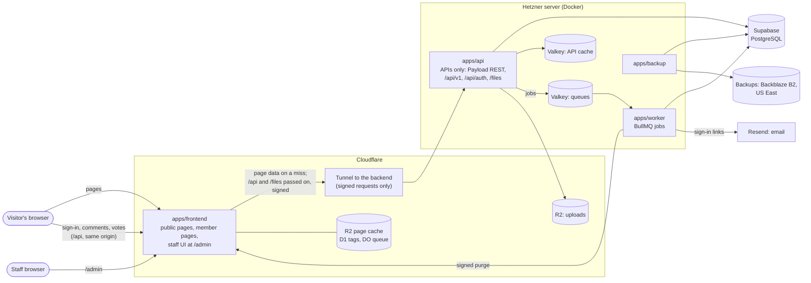

# 0014: Split one frontend, the site and the admin, from an API-only backend

- Date: 2026-10-20
- Status: Accepted (2026-10-21)

## Context

Today one Next.js app (`apps/web`) does everything a visitor or admin
touches:

- renders the public pages, reading the database directly through Payload's
  local API (`src/public/cached.ts`, `content.ts`);
- runs sign-in (Better Auth, `/api/auth/*`) and the member API (`/api/v1/*`:
  comments, votes, reports, account, notifications, feedback, data export,
  browsing, error reports);
- serves Payload's admin panel (`/admin`) and Payload's REST API (`/api`);
- serves uploaded files (`/files/[id]`);
- puts jobs on the BullMQ queues (email, reference and video checks, link
  archives, search index) and keeps its page cache in Valkey (ADR 0013).

The developer wants both user interfaces, the public site and the admin, in
one frontend app on Cloudflare Workers (decided 2026-10-20). The Hetzner
server would only answer API calls: it renders no HTML and holds the
database, queues, caches, and secrets.

Facts that shape the design:

- **The public pages' data is already plain JSON** (`src/public/types.ts`,
  ADR 0007). It can be served over HTTP unchanged.
- **Staff permissions live in the backend.** Every collection's access rules
  (`verifiedStaffOnly`, `verifiedAdminsOnly` in `src/access.ts`, which
  require a staff role and a recent authenticator check), its validation
  (`refuse()`, the evidence and reference checks before publishing), its
  audit log, and its purges run in Payload's hooks. They apply to Payload's
  REST API exactly as they apply to its admin panel. A new admin frontend
  therefore changes no rule; it only calls the API.
- **Payload's admin panel cannot run apart from Payload.** Its screens are
  server components that use Payload's local API, with the database
  connection in the same process. It cannot be deployed to Workers or
  pointed at a remote API. The admin is therefore rebuilt in the frontend,
  on Payload's REST API.
- **Writes already check their origin** (`isSameOriginWrite`, against
  `SITE_URL`). Browsers keep talking to one origin, the frontend's, so that
  check stays as it is.

Constraints of Cloudflare Workers that matter here:

- **Runtime:** OpenNext's Cloudflare adapter supports Next.js 16. Each
  isolate has 128 MB of memory and a 1-second startup limit. There are no
  long-lived TCP connections to Redis, so ioredis, BullMQ, and the Valkey
  cache handler cannot run there.
- **Cache:** `revalidateTag` works through OpenNext's tag cache. Pages are
  stored in R2, tags in D1 or Durable Objects, and time-based revalidation
  runs through a Durable Object queue.

## Decision

### Shape

| Part                                      | Runs on                                | Holds                                                                                                 | Address                                                                                                            |
| ----------------------------------------- | -------------------------------------- | ----------------------------------------------------------------------------------------------------- | ------------------------------------------------------------------------------------------------------------------ |
| `apps/frontend` (new)                     | Cloudflare Workers, one Worker         | The public pages, the member pages, and the staff UI under `/admin`                                   | `https://<domain>`, with the admin at `<domain>/admin`                                                             |
| `apps/api` (today's `apps/web`, renamed)  | Hetzner (Docker)                       | Payload without its admin panel, sign-in, Payload's REST API, `/api/v1`, page data, `/files`. No HTML | None of its own: reached at `<domain>/api/*` and `<domain>/files/*` through the frontend, then a Cloudflare Tunnel |
| `apps/worker`, `apps/backup`              | Hetzner (Docker)                       | Unchanged                                                                                             | Not public                                                                                                         |
| PostgreSQL, two Valkeys, uploads, backups | Supabase / Hetzner / R2 / Backblaze B2 | Unchanged, except that backups go to Backblaze B2 (Everything else)                                   | Not public                                                                                                         |

The frontend imports nothing from Payload, `pg`, ioredis, or
`@countrytopics/jobs`, except Payload's rich-text renderer
(`@payloadcms/richtext-lexical/react`), which phase 1 showed runs on
Workers without bringing Payload's server code with it. It holds no
database, queue, or service credentials.
A lint rule (`no-restricted-imports`) enforces the imports. Its only secrets
are narrow keys:

- the purge key, which checks the worker's purges (Cache and purges);
- the forwarding key, which signs every request it passes to the backend,
  with the visitor's address (Sign-in and API calls);
- a Cloudflare token limited to purging the zone's cache, if phase 1 shows
  OpenNext needs one;
- on staging only, a Cloudflare Access service token for the backend's
  Tunnel host (Environments).

Inside the frontend, the site and the admin are two route groups, each with
its own root layout, so neither loads the other's header, styles, or
scripts:

- `app/(site)/…`: the public pages and the member pages;
- `app/(admin)/admin/…`: the staff UI.



### Repository

```
apps/
  frontend/    Next.js on Workers: the site and the admin, an API client
  api/         Next.js + Payload on Hetzner, APIs only (renamed from apps/web)
  worker/      unchanged
  backup/      unchanged
packages/
  contracts/   new: request and response types and zod schemas for /api/v1 and
               the page data; Payload's generated types for the REST API
  domain, jobs, observability, search, sources, email: unchanged
```

### The backend: APIs only

- **No admin panel.** The `app/(payload)/admin` route group is removed;
  Payload's REST routes (`app/(payload)/api`) stay. Payload keeps its
  collections, hooks, access rules, versions, and uploads.
- **Its paths**, which visitors reach only through the frontend at
  `<domain>`:
  - `/api/<collection>`: Payload's REST API, used by the admin;
  - `/api/v1/*`: the member API, plus the new page-data endpoints;
  - `/api/auth/*`: sign-in;
  - `/files/:id`: uploaded files.
- **It answers only the frontend.** Its Tunnel host (`api.<domain>`,
  `api-dev.<domain>` on staging, one level deep so Cloudflare's free
  certificate covers it) refuses any request without the frontend's
  signature, so it is not a public API. The exceptions are
  `/api/v1/health`, which reveals nothing and is what the containers' and
  Caddy's health checks call, and the rehearsal and load tests, which sign
  their requests with that environment's key.
- **Its links and redirects name the frontend.** Routes that redirect, such
  as the browse and comment routes' canonical redirects, build their URLs
  from `SITE_URL` instead of the request's own address, which is the
  Tunnel host behind the pass-through.
- **The REST API is staff-only for writes**, as now: the access rules
  refuse anyone without a staff role and a recent authenticator check. With
  the admin panel gone, the REST API also gets rate limits for staff writes,
  and `/api/<collection>` reads open to the public only where they are today.
- **No GraphQL.** Payload's GraphQL API stays turned off
  (`graphQL: { disable: true }`, as now); REST covers the site and the
  admin.
- **The page-data endpoints** replace the site's direct reads, served
  through the existing `cached()` loaders so Valkey still absorbs repeated
  reads:

  | Endpoint                              | Replaces                |
  | ------------------------------------- | ----------------------- |
  | `GET /api/v1/pages/home`              | `homePage()`            |
  | `GET /api/v1/pages/topics/:slug`      | `topicPage()`           |
  | `GET /api/v1/pages/countries/:slug`   | `countryPage()`         |
  | `GET /api/v1/pages/individuals/:slug` | `individualPage()`      |
  | `GET /api/v1/topics`, browse terms    | Already HTTP (ADR 0008) |

  A missing or unpublished item answers 404. File URLs stay as they are
  (`/files/:id`), on the frontend's host.

### The admin

The admin is part of `apps/frontend`, at `/admin`. It rebuilds what staff
use in Payload's admin panel today, on Payload's REST API (`?depth=`,
`?draft=true`, `/versions`, multipart uploads):

- **Sign-in and the authenticator gate**, reusing the account page's
  two-factor flow. The backend's access rules stay the real check.
- **Lists** for the 17 collections Payload's panel shows today (comment
  votes and notifications stay hidden), with search, filters, sorting, and
  pagination, as its list views offer now.
- **The topic editor:**
  - the rich-text body, using Lexical (the editor Payload's rich text is
    built on), saving the same JSON so the site renders it unchanged;
  - internal links to topics and individuals;
  - people, evidence, and references;
  - the workflow: draft, ready for review, publish, archive, with the change
    note;
  - version history and restoring a version.
- **The other editors:** countries, categories, tags, individuals (with
  statements and the possible-duplicates check), references (with the lookup
  by DOI or ISBN), media uploads with licence and credit, snippets (the
  existing snippet editor and preview, moved into the frontend), videos and
  link archives (their check status).
- **Moderation and people:** comments and reports (hide, lock), feedback,
  invitations, users and roles, and the audit log.
- **Errors from the API**, such as a refused publish because a reference is
  unconfirmed, shown beside the field they name, as Payload's panel does.
- **Everything else Payload's panel does today**, because the developer
  decided the new admin must match it in full (2026-10-20):
  - bulk actions on lists (select many, then publish, archive, or delete
    where the access rules allow);
  - autosave of drafts while editing;
  - live preview of a topic as visitors will see it;
  - comparing two versions side by side, and restoring one;
  - document locking, so two editors cannot overwrite each other;
  - duplicating a record;
  - choosing list columns, with filters remembered per staff member;
  - creating a related record without leaving the editor (a new reference
    from a topic, say);
  - image uploads by drag and drop, several at once, with a focal point;
  - a dashboard of recent work and items waiting for review.

How the admin sits in the same app as the site:

- **Never cached.** Every admin screen is rendered per request with the
  staff member's cookie and sent with `Cache-Control: private, no-store`.
- **Gated twice.** The frontend asks the backend for the session before it
  renders anything under `/admin`, and sends anyone without a staff role to
  sign-in. The backend's access rules remain the real check: the admin's
  scripts hold no secret and no permission, so a visitor who downloads them
  gains nothing.
- **Heavy parts load in the browser.** The rich-text editor, drag-and-drop
  uploads, and version comparison are loaded with `next/dynamic` and
  `ssr: false`. They ship as static files, which do not count towards the
  Worker's size limit (10 MB compressed on Workers Paid), and visitors to
  the public pages never download them.
- **One deploy.** A change to the admin redeploys the site too, and the
  reverse. Both are tested together on staging before promotion.

### Sign-in and API calls, through the frontend

Browsers only ever talk to the frontend's host. The frontend passes
`/api/*` and `/files/*` on to the backend, so the session cookie never needs
to cover another host. That is what lets staging live at `dev.<domain>`
(Environments): production's cookie is never sent there.

- **The pass-through:** a route in the frontend forwards each `/api/*` and
  `/files/*` request to the backend's Tunnel host unchanged: method, body
  (streamed), cookies, and response headers, including every `Set-Cookie`.
  It fetches with `redirect: "manual"`, so a redirect, such as the one that
  ends a Google or email sign-in with its cookie, reaches the browser
  instead of being followed in the Worker. As a safeguard, it rewrites any
  `Location` that names the Tunnel host to the frontend's host. The one
  path it does not pass on is `/api/revalidate`, which the frontend answers
  itself (Cache and purges). Uploads fit Cloudflare's request limit (100 MB on
  the Free and Pro plans; the media limit is 20 MB).
- **Every passed-on request is signed.** The frontend adds the visitor's
  address (from Cloudflare's header) and a signature with the forwarding
  key: an HMAC over the method, the path with its query, the address, and
  a timestamp. The body is not signed: the signature proves the request
  came through the frontend, and TLS protects the rest. The backend refuses
  unsigned requests and timestamps more than 5 minutes off its own clock,
  which allows for drift between Cloudflare's and Hetzner's clocks. It
  takes the client address only from a signed request, for Better Auth's
  limits and its own, so rate limits still count each visitor. Locally,
  where no Cloudflare header exists, the frontend signs `127.0.0.1`, so
  local requests share one bucket, as they do today.
- **The frontend's own calls are signed too:** member pages, the `/admin`
  gate, and page data. Its cached page-data reads put the signed fetch
  inside a `"use cache"` function keyed by the path. Next.js puts a fetch's
  headers in its cache key, so a fresh signature on every call would
  otherwise mean the cache never hits.
- **Cookies stay host-only and carry the `__Host-` prefix.** Better Auth's
  cookies are set without a `Domain` attribute, as now, so browsers send
  them only to `<domain>`, never to `dev.<domain>` or any other host. The
  prefix is required, not optional: browsers refuse a `__Host-` cookie
  that names a domain, so staging, which is same-site with production,
  cannot plant a session cookie that production would read. If Better Auth
  cannot name its cookies that way, the pass-through adds the prefix to
  every `Set-Cookie` on the way out and removes it from `Cookie` on the way
  in. Tests check that no response sets a `Domain` attribute and that every
  session cookie has the prefix.
- **No CORS.** Every browser call is same-origin, so `isSameOriginWrite`
  and Payload's `csrf` keep checking against `SITE_URL`, as today.
- **Payload's panel during the move, locally only.** Until phase 12
  removes it, staff use Payload's panel at the backend's own address,
  `localhost:3002/admin`. Browsers do not tie cookies to a port, so the
  same sign-in works there. While the panel exists, and only with
  `APP_ENV=local`, the backend also accepts its own address as an origin
  and unsigned requests from its own panel. No hosted environment exists
  before phase 13 (Until a launch), so none ever has the panel.
- **Member pages** (account, notifications, feedback, the sign-in redirect)
  are rendered by the frontend per request, sending the visitor's cookie to
  the backend. They are never cached.
- **Callback addresses:** Google's redirect is
  `https://<domain>/api/auth/callback/google`, and email links point at
  `<domain>/api/auth/*`, as today.
- **Staff and members sign in the same way**, on the same pages; staff
  then pass the authenticator check before the admin opens.

### Cache and purges

- **On the site:** OpenNext's small-site setup: an R2 incremental cache, the
  D1 tag cache, and the Durable Object queue. Pages keep `revalidate =
3600`. Their fetches carry the backend's tags (`public-cache.ts`).
- **Purges cross hosts.** `purgePublicPages()` still purges the backend's
  Valkey cache in `after()`, once the change is committed. Only when that
  purge has been written is a `purge` job queued (by the backend's cache
  handler; Phase 6 results), so the frontend's next miss cannot fetch, and
  cache for an hour, the old data. The worker sends the job to the site as
  `POST /api/revalidate` with the tags, signed with the purge key (HMAC,
  timestamped, rejected after 5 minutes). The site calls `revalidateTag`,
  which OpenNext records in its D1 tag cache. A failed purge is retried;
  the hourly revalidation bounds staleness if every retry fails.
- **The Valkey page cache stays** on the backend, now holding API responses.

### Everything else

- **Where data is stored: the US only**, for every member, wherever they
  live (the developer, 2026-10-20; ADR 0012 already put Sentry there):
  - the Hetzner server in Ashburn, Virginia, and the Supabase project in
    East US (North Virginia), close together so database calls stay short;
  - R2 buckets and the D1 database created with Cloudflare's eastern North
    America location hint (`enam`), which Cloudflare follows on a
    best-effort basis; they hold staff uploads and cached public pages;
  - backups on Backblaze B2 in its US East region, not R2, so that one
    account or outage cannot take the uploads and every backup together, as
    ADR 0012 requires;
  - Resend sending from its US region, and Sentry's US region, as now.

  Cloudflare's edge, outside the US too, may hold copies of responses that
  carry only published content: public pages and staff uploads. Nothing
  with members' data is stored there:
  - member pages and the admin are never cached;
  - the comment lists keep their short browser and Valkey caching but send
    `Cloudflare-CDN-Cache-Control: no-store`, so Cloudflare does not store
    members' names and comments.

  Staging uses the same regions. The privacy policy says that all data is
  stored in the US.

- **Error reporting:** each app reports its own errors. The frontend uses
  Sentry's Cloudflare SDK with the scrubbing from
  `@countrytopics/observability`. Browser reports still go through the
  backend's `/api/v1/errors`.
- **Turnstile:** the widget is on the site; the backend checks the token.
- **Video thumbnails come from the site.** Today the snippet player loads
  each thumbnail from YouTube's image server (`i.ytimg.com`) when a topic
  page opens, so visitors' browsers contact Google before anyone presses
  play. Instead:
  - A frontend route, `/thumbnails/:youtubeId`, fetches the thumbnail from
    `i.ytimg.com` on the visitor's behalf, with no cookies and none of the
    visitor's headers. It accepts only a valid 11-character video ID and
    fetches only that fixed address, so it cannot be used to reach anywhere
    else.
  - Cloudflare's edge keeps each image for a day (`max-age=86400`). Nothing
    is stored in R2, in the database, or in backups, so a changed or
    removed thumbnail disappears within a day, and the worker, the media
    model, and `/files` do not change.
  - The public pages and the admin's snippet editor both use the route, so
    neither loads an image from Google. YouTube is contacted directly only
    when someone presses play.
  - Phase 5 checks that YouTube's terms allow thumbnails passed through
    this way. If they do not, the player shows a neutral placeholder until
    it is clicked, the developer's second choice.
- **No pgvector.** It was installed (the `pgvector/pgvector:pg17` image)
  but nothing uses it: search is Postgres full-text. In phase 0:
  - Compose and CI's integration tests both move to the plain `postgres:17`
    image, so tests run on the same database as local and production.
  - A migration runs `DROP EXTENSION IF EXISTS vector`, so a local database
    that once loaded it no longer writes `CREATE EXTENSION vector` into its
    backups, which would then fail to restore without it.
  - README.md and the checklist stop mentioning pgvector.

  Supabase's projects are created without the extension. It comes back only
  with semantic search.

- **Design:** the site and the admin share the tokens and fonts from PR
  #18, in the frontend. PR #18 is merged before phase 5, whose checks
  compare against its screenshots.
- **Local development:** see Environments below.

### Environments

The developer decided (2026-10-20) that development and production are kept
apart, and that every environment has the split's shape from the first
phase, so that nothing first meets the pass-through, its signatures, or
the Workers runtime in production.

There are three environments on one domain: production at `<domain>` and
staging at `dev.<domain>` (decided 2026-10-21); until a launch only the
local one exists (Until a launch). Each environment has the
same two apps reached the same way; they share code, never data, secrets,
or cookies.

| Service           | Local (each developer's machine)                                                              | Staging (hosted, for testing)                                                        | Production                                                             |
| ----------------- | --------------------------------------------------------------------------------------------- | ------------------------------------------------------------------------------------ | ---------------------------------------------------------------------- |
| Addresses         | `localhost:3000`, `/admin`; the backend on `localhost:3002`, reached through the pass-through | `dev.<domain>`, `dev.<domain>/admin`; the backend's Tunnel host `api-dev.<domain>`   | `<domain>`, `<domain>/admin`; the backend's Tunnel host `api.<domain>` |
| Frontend          | `next dev`                                                                                    | Its own Worker (`frontend-staging`), R2 bucket, and D1 database                      | Its own Worker, R2 bucket, and D1 database                             |
| Backend           | Docker Compose                                                                                | Its own small Hetzner server and Tunnel                                              | Its own Hetzner server and Tunnel                                      |
| Database          | PostgreSQL 17 in Docker                                                                       | Its own Supabase project, in a separate Supabase organisation                        | Its own Supabase project                                               |
| Email             | Mailpit; nothing leaves the machine                                                           | Resend, sending from `dev.<domain>` with its own API key; sends only to an allowlist | Resend, the production domain and key                                  |
| Sign-in providers | Google's and Turnstile's test settings                                                        | Their own Google client and Turnstile widget                                         | Their own Google client and Turnstile widget                           |
| Error reports     | Off                                                                                           | Sentry, `environment: staging`                                                       | Sentry, `environment: production`                                      |
| Backups           | None                                                                                          | Its own Backblaze B2 bucket                                                          | Its own Backblaze B2 bucket                                            |
| Secrets           | `.env` (never committed)                                                                      | GitHub environment `staging`                                                         | GitHub environment `production`, with an approval                      |
| Data              | Synthetic                                                                                     | Synthetic only                                                                       | Real; never copied to another environment                              |
| Who can open it   | The developer                                                                                 | Staff and named testers, through Cloudflare Access on `dev.<domain>`                 | The public, if the platform launches                                   |

Rules that keep them apart:

- **Production's cookies never reach staging.** They are host-only on
  `<domain>` (Sign-in and API calls), so browsers do not send them to
  `dev.<domain>`, and staging's are host-only on `dev.<domain>`. Nothing in
  either environment sets a cookie for the whole domain.
- **Every app knows its environment.** `APP_ENV` is `local`, `staging`, or
  `production`, and each app refuses to start when an address belongs to
  another environment (`@countrytopics/environment`):
  - local: the site only on this machine (`localhost`, a private network
    address) or a quick-tunnel demo address, and every service (database,
    Valkey, storage, email) on this machine or in a container beside it,
    never a hosted one, so a laptop cannot reach staging's or production's
    data;
  - staging: the site at an `https://dev.` address;
  - production: the site at any other public `https://` address, never
    staging's;
  - staging and production: no service on `localhost`, every http service
    over HTTPS, and every service address naming a single host.

  Hostnames are compared label by label, never by suffix, since
  `dev.<domain>` ends with production's domain. `APP_ENV` defaults to
  `local` rather than being required: local accepts only this machine's
  addresses and services, so a hosted environment that forgets it cannot
  start. `APP_ENV` also labels Sentry's reports (`development`, `staging`,
  `production`) unless `SENTRY_ENVIRONMENT` is set. This
  joins the check in `src/env.ts` that refuses Turnstile's test keys
  outside `localhost`.

- **Staging is closed to the public from its first day.** Cloudflare
  Access covers `dev.<domain>`, except `/api/revalidate`, which checks its
  own signature, and the backend's Tunnel host, `api-dev.<domain>`. The
  staging frontend passes Access with a service token that exists only in
  staging. Both hosted environments start in phase 13, after the
  signatures exist; production has no Access.
- **One build, promoted.** A merge to `main` builds the two apps once and
  deploys them to staging, after the database migrations run there. The same
  build reaches production only through a manual promotion with the
  `production` environment's approval, which runs production's migrations
  first. Payload's schema push stays off everywhere (`push: false`).
- **Nothing flows down.** Production data is never restored into staging or
  a laptop; the restore drill restores into a new production-side database,
  as now (ADR 0012). Staging's data is made by the seed scripts and the
  rehearsal.
- **Separate credentials.** Each environment's database password, Better
  Auth secret, purge key, forwarding key, and service keys are its own, so
  staging's keys can never sign a request that production's backend
  accepts, and the
  Cloudflare deploy token for staging cannot touch production's Worker.
- **Local runs the same pass-through.** `next dev` serves the frontend on
  `localhost:3000` and passes `/api` and `/files` to the backend on
  `localhost:3002` with the same signed route, so sign-in, cookies, and
  redirects behave as in production.

Staging costs about $10–30 a month (a small Hetzner server and Supabase's
free plan in its own organisation); it needs no domain of its own.
Cloudflare, Sentry, and Resend use the same accounts as production.

#### Until a launch: local and free

There is no pilot for now: the developer will show the split to their
manager as a demo (2026-10-21). Phases 0–12 are therefore built and tested
on the developer's machine and in CI, using free services only. Hosted
staging and production, and every paid service and account, wait for
phases 13 and 14, which happen only if a launch is decided.

Until then each production service has a local stand-in that speaks the
same interface, so moving to the real one is a change of configuration:

| Production service       | Local stand-in until phase 13                                                                                                               | Shared interface                       |
| ------------------------ | ------------------------------------------------------------------------------------------------------------------------------------------- | -------------------------------------- |
| Cloudflare Workers       | `opennextjs-cloudflare preview`, which runs the frontend in workerd, the Workers runtime, with Wrangler's local R2, D1, and Durable Objects | The Worker's bindings                  |
| Hetzner server           | Docker Compose                                                                                                                              | The same container images              |
| Cloudflare Tunnel        | A direct connection to `localhost:3002`                                                                                                     | The pass-through's backend address     |
| Supabase                 | PostgreSQL 17 in Docker                                                                                                                     | `DATABASE_URL`                         |
| R2 for uploads           | SeaweedFS                                                                                                                                   | The S3 API                             |
| Backblaze B2 for backups | A second SeaweedFS bucket                                                                                                                   | The S3 API                             |
| Resend                   | Mailpit                                                                                                                                     | SMTP (`SMTP_URL`; Resend accepts SMTP) |
| Cloudflare Access        | None needed: nothing is public                                                                                                              | None                                   |
| Sentry                   | Sentry's free plan, as now                                                                                                                  | The DSN                                |

Free tiers that may help before phase 13, and that nothing depends on:

- **Cloudflare's free plan.** A free account, with no payment, lets the
  phase 1 spike deploy to `workers.dev` if it fits the free plan's limits
  (3 MB of compressed code and 10 ms of CPU a request). If it does not, the
  spike is judged locally: Wrangler's dry run reports the compressed size,
  which must fit Workers Paid's 10 MB.
- **Supabase is not tried early.** The local environment refuses hosted
  services by design, so Supabase, and its pooler, are first met in phase 13.

**Demos** use Cloudflare's free quick tunnel, which needs no account: it
gives the local frontend a temporary `trycloudflare.com` address, as for
the earlier demo. Because browsers only ever talk to the frontend, the
tunnel exposes the frontend alone, and the backend stays on the machine.
The address changes each time the tunnel restarts.

**What is first met in phase 13**, and so carries that phase's risk:
Hetzner and the Tunnel, Supabase's paid plan, Workers Paid under real
traffic, Backblaze B2, Resend and the domain, Cloudflare Access, and the
promotion workflow. Phase 14's load test and restore drill are the first
runs on the real services.

## Plan

Each phase ends with its checks passing and is a PR of its own, as AGENTS.md
asks. Estimates are working days for one developer with Claude. The two
spikes are go/no-go gates: if one fails, stop and revisit this decision.
Phases 0–12 run locally and in CI (Until a launch); phases 13 and 14
happen only if a launch is decided.

| Phase                         | Work                                                                                                                                                                                                                                                                                                                                                   | Done when                                                                                                                                                                                                                                          | Days                                                               |
| ----------------------------- | ------------------------------------------------------------------------------------------------------------------------------------------------------------------------------------------------------------------------------------------------------------------------------------------------------------------------------------------------------ | -------------------------------------------------------------------------------------------------------------------------------------------------------------------------------------------------------------------------------------------------- | ------------------------------------------------------------------ |
| 0. Local environment          | `APP_ENV` and the start-up checks; `postgres:17-bookworm` without pgvector, in Compose and CI; the migration that drops the extension; the environments table kept as the target for phase 13                                                                                                                                                          | Each app refuses another environment's addresses; CI and Compose run the same database image                                                                                                                                                       | 2–3                                                                |
| 1. Site spike                 | A throwaway OpenNext build of the topic page, run in the local workerd preview, and on `workers.dev` if it fits the free plan                                                                                                                                                                                                                          | The page renders its rich text in the Workers runtime; its compressed size fits Workers Paid's 10 MB; `revalidateTag` purges it; fonts load; Sentry reports                                                                                        | 2–3                                                                |
| 2. Admin spike                | A throwaway `/admin` page in the same build that edits one topic through the REST API: the Lexical body, one relation, saving a draft, publishing                                                                                                                                                                                                      | The saved JSON renders unchanged on the site; the Worker with the admin in it still fits; public pages load none of the admin's scripts; a refused publish shows its error                                                                         | 3–4                                                                |
| 3. Contracts and page data    | `packages/contracts`; the four `/api/v1/pages/*` endpoints; integration tests                                                                                                                                                                                                                                                                          | Each endpoint returns exactly what the page builds today; drafts and archived items answer as the pages do                                                                                                                                         | 3–4                                                                |
| 4. API through the frontend   | The pass-through for `/api` and `/files`; request signatures and the visitor's address; redirects built from `SITE_URL`; `__Host-` cookies; the local-only allowance for Payload's panel; staff write limits; `/security-guidance` review                                                                                                              | Sign-in, comments, votes, reports, account deletion, export, and a staff edit work through the frontend; an unsigned request to the backend is refused; sign-in's redirects keep their cookies; every session cookie is `__Host-` with no `Domain` | 3–4                                                                |
| 5. `apps/frontend`            | Move the public pages and components; the API client; member pages with the forwarded cookie; the admin route group and its gate; the thumbnail route                                                                                                                                                                                                  | Every page matches PR #18's screenshots and passes the whole-site audit                                                                                                                                                                            | 6–8                                                                |
| 6. Purges                     | The `purge` job, `POST /api/revalidate`, signature checks                                                                                                                                                                                                                                                                                              | Publishing changes the site within seconds; a forged or old purge is refused; a failed one retries                                                                                                                                                 | 2                                                                  |
| 7. Admin shell and lists      | Sign-in and the authenticator gate, navigation, list views for the 17 collections                                                                                                                                                                                                                                                                      | Staff can find any record as fast as in Payload's panel                                                                                                                                                                                            | 5–7                                                                |
| 8. Topic editor               | Body, links, people, evidence, references, workflow, change notes, versions, field errors                                                                                                                                                                                                                                                              | An editor publishes a real topic end to end; every refusal Payload's panel showed is shown                                                                                                                                                         | 8–12                                                               |
| 9. Other editors              | Countries, categories, tags, individuals, references, media, snippets, videos, link archives                                                                                                                                                                                                                                                           | Each record type can be created, edited, and checked as today                                                                                                                                                                                      | 6–9                                                                |
| 10. Moderation and people     | Comments, reports, feedback, invitations, users and roles, audit log                                                                                                                                                                                                                                                                                   | The moderation manual tests from weeks 9 and 10 pass in the new admin                                                                                                                                                                              | 4–6                                                                |
| 11. Admin parity              | Bulk actions, autosave, live preview, version comparison, document locking, duplicating, list columns and remembered filters, inline creation of related records, multi-file uploads with a focal point, the dashboard                                                                                                                                 | Every feature staff use in Payload's panel today has its counterpart; Payload's panel can be removed without loss                                                                                                                                  | 10–15                                                              |
| 12. Backend clean-up          | Remove Payload's admin panel, its local-only allowance, and the public pages from the backend; rename `apps/web` to `apps/api`; update AGENTS.md and the docs that ADR 0014 supersedes                                                                                                                                                                 | The backend answers no HTML; the import lint rules pass                                                                                                                                                                                            | 2–3                                                                |
| 13. Hosting, if launched      | The domain; the accounts (Cloudflare Workers Paid, Hetzner, Supabase, Backblaze B2, Resend), in the developer's name; staging at `dev.<domain>` and production, each with its Worker, R2, D1, Supabase project, server, Tunnel, and keys; Cloudflare Access on staging; the promotion workflow; the runbooks, including the ownership-transfer runbook | A build promoted from staging serves production, with production's migrations run first; staging serves `dev.<domain>` behind Access                                                                                                               | 5–7                                                                |
| 14. Verification, if launched | Load test through Workers and the Tunnel; Smart Placement on and off; `make scale-check`; restore drill; every manual test so far, in the new admin                                                                                                                                                                                                    | 500 simultaneous visitors with no failures and a 95th percentile under 500 ms for uncached pages                                                                                                                                                   | 3–4                                                                |
| **Total**                     |                                                                                                                                                                                                                                                                                                                                                        |                                                                                                                                                                                                                                                    | **56–80 for phases 0–12 (about 11–16 weeks); 8–11 more to launch** |

About two-thirds of phases 0–12 (phases 2 and 7–11) is the admin frontend.

### Phase 1 results (2026-10-21)

The site spike (`prototypes/workers-spike`) passed every check, run
locally in workerd, the Workers runtime; there is no Cloudflare account
yet, so it was not deployed to `workers.dev`:

| Check                            | Result                                                                                                                                                                                   |
| -------------------------------- | ---------------------------------------------------------------------------------------------------------------------------------------------------------------------------------------- |
| Rich text in the Workers runtime | apps/web's renderer, copied, rendered headings, bold and italic, lists, quotes, and external and internal links, and dropped empty paragraphs, for a TEST topic and a real published one |
| Size                             | 1.17 MB compressed (5.6 MB raw): under the free plan's 3 MB and Workers Paid's 10 MB                                                                                                     |
| Start-up                         | About 56 ms of CPU locally (`wrangler check startup`), against a 1-second limit                                                                                                          |
| Caching                          | Repeat requests are cache hits from R2, with no call to the backend                                                                                                                      |
| Purge by tag                     | With apps/web's tags (`public:topics` and the rest): an edit stays hidden until the tag is purged, then the next request renders it; a forged purge or an unknown tag is refused         |
| Background refresh               | Once a page's lifetime is over it is served stale once, while the Durable Object queue fetches the new data and renders it                                                               |
| Fonts                            | `next/font`'s files are served from the Worker's assets as `font/woff2`                                                                                                                  |
| Error reports                    | Errors reach Sentry with no user, cookies, or other personal data, from Sentry's own settings and again from the site's scrubbing                                                        |

What it changes for the later phases:

- **Sentry 11 collects personal data unless told not to.** Its old
  `sendDefaultPii: false`, which every SDK in the repository was given, no
  longer exists; the new `dataCollection` option collects users, cookies,
  headers, bodies, query strings, and local variables by default. The
  spike's first reports carried the visitor's cookie and a user. The shared
  `ERROR_REPORTING_DEFAULTS` now turn all of it off, for the site, the
  worker, and the backup tool as well, and `scrubErrorEvent` stays as the
  second line of defence. Before this, the scrubbing alone had kept it out
  of the reports.
- **Topic pages keep `generateStaticParams` returning `[]`,** as apps/web's
  do. Without it Next.js renders them on every request and caches nothing.
- **On this Windows machine, OpenNext builds only on Linux:** its build
  makes symbolic links, which Windows allows only in Developer Mode. The
  Workers preview runs in a container (the spike's `Dockerfile`);
  `next dev` still runs on Windows for everyday work.
- **The local preview leaves out `global_fetch_strictly_public`,** which
  stops a Worker reaching `127.0.0.1`. Hosted Workers keep it, since their
  backend is a public Tunnel address.
- **Wrangler warns that the queue's class is not exported,** although the
  built Worker exports it and the background refresh worked. Phase 13
  checks it on a real deploy.
- Not checked locally: the free plan's 10 ms of CPU per request, which
  only a deploy can measure.

The developer decided (2026-10-20) to build the split from the beginning,
and later (2026-10-21) that there is no pilot for now: the split is built
locally and shown as a demo, and phases 13 and 14 wait for a launch.

### Phase 2 results (2026-10-21)

The admin spike (`prototypes/workers-spike/app/(admin)`) passed every
check. It ran in workerd against the real local backend (apps/web), as a
TEST admin signed in by email link and authenticator:

| Check                        | Result                                                                                                                                                                                                                                                                                                                                                                    |
| ---------------------------- | ------------------------------------------------------------------------------------------------------------------------------------------------------------------------------------------------------------------------------------------------------------------------------------------------------------------------------------------------------------------------- |
| The saved JSON               | The editor writes what Payload's editor writes. This was checked against Payload's own node classes for a body with every node and format apps/web allows, the TEST fixture, and all 29 topic bodies and versions in the local database, both read and written back and again after the editor showed them on a page. Edits made in a browser were stored exactly as sent |
| It renders unchanged         | apps/web's topic page rendered the TEST topic's headings, formats, external and internal links, nested and numbered lists, quote, and rule                                                                                                                                                                                                                                |
| One relation, draft, publish | The countries, a draft save, and two publishes, through Payload's REST API with the staff member's cookie. The access rules, the workflow, the change log, the versions, and the audit log ran as they do for Payload's panel                                                                                                                                             |
| A refused publish            | Publishing an empty body was refused on Body ("Write the topic before publishing."), and publishing again without a change note on Change note; each message showed beside its field                                                                                                                                                                                      |
| Size                         | 1.21 MB compressed (5.9 MB raw), 38 KB more than phase 1: the editor itself ships as static files                                                                                                                                                                                                                                                                         |
| Start-up                     | 30–60 ms of CPU locally across three runs, as in phase 1                                                                                                                                                                                                                                                                                                                  |
| Public pages load no admin   | The public pages load none of the admin's three scripts or its stylesheet (285 KB, 92 KB gzipped), and the admin loads none of the site's styles. The Lexical chunk (261 KB) loads only on the editor page, once it has opened                                                                                                                                            |
| Never cached                 | Admin pages are sent with `private, no-cache, no-store`                                                                                                                                                                                                                                                                                                                   |

What it changes for the later phases:

- **Only three of the editor's nodes are Payload's own.** Payload's editor
  uses Lexical's heading, quote, and list nodes as they are; the link,
  autolink, and horizontal rule are its own classes. The admin mirrors
  those three (`body-nodes.ts`), because importing them from
  `@payloadcms/richtext-lexical` would bring Payload's admin UI into the
  browser. Lexical stays at the version Payload uses (0.50.0 with Payload
  3.90.2), and the body test (`tests/body-json.test.ts`) runs whenever
  either is upgraded. Phase 8 moves the nodes and the test into the
  frontend.
- **"Unchanged" means what Payload's editor would save.** 19 of the 29
  local bodies lack the paragraphs' `textStyle`, which Lexical now adds.
  Payload's editor would add it on their next save too, and the renderer
  ignores it.
- **Payload's renderer ignores a numbered list's `start`.** It numbers
  each item through its `value`, so a list still counts from the right
  number.
- **The stand-in pass-through rewrites a write's origin** to the backend's
  own address, after checking the browser's origin against the frontend's.
  Phase 4's signed pass-through replaces it.
- **An unknown address gets Next.js's plain 404,** as apps/web does today,
  because the two route groups have separate root layouts. Phase 5 adds
  `global-not-found`.

### Phase 3 results (2026-10-21)

The four page-data endpoints answer from the same cached loaders as the
pages, with `Cache-Control: no-store`: the frontend caches the data itself
and purges it by tag, and a cache between the two could not be purged.

- **Exactly what the page builds.** Integration tests compare each
  endpoint's JSON with its loader's, for the home page, a published and an
  archived topic, a country, and two people. Drafts, unknown and malformed
  slugs, and people no published topic names answer 404, as their pages
  do. Against the local database, all 269 addresses answered the same
  status as their pages, and every answer passed its contract.
- **The contracts.** `packages/contracts` holds zod schemas for the
  public read model (the four pages and browsing), the types made from
  them, which apps/web's `src/public/types.ts` re-exports, each endpoint's
  path, and the cache tags its data is purged by.
  - Parsing drops any field a schema does not list, so the backend, which
    deploys apart from the frontend, can add one before the frontend uses
    it. The backend's tests check that every answer parses unchanged, so a
    field it starts sending by mistake, such as a staff-only one, fails
    there.
  - The rich-text body is checked at its root and its top-level nodes.
  - The paths helper refuses anything but a slug, so no path built from a
    visitor's address can reach another endpoint with the frontend's
    signature.
- **The body names only public pages.** An internal link to a draft or a
  private profile keeps its text but loses its target, as the page already
  showed it. The rendered page never named such a document, but its JSON
  would have.
- **Repeated reads come from Valkey,** in about 6 ms locally.
- **Not in phase 3:** the member API's request and response schemas move
  into `packages/contracts` in phase 5, with the components that call them,
  and Payload's generated types for the REST API in phase 7, with the
  admin's lists. The licence list moved into `@countrytopics/domain`, so
  the contracts depend on no app.

### Phase 4 results (2026-10-21)

Browsers now reach the backend only through the frontend. `apps/frontend`
passes each request on, signed (`packages/forwarding`), and the backend's
`proxy.ts` refuses anything unsigned. Locally the frontend runs on
`localhost:3000` (`next dev`) and the backend on `localhost:3002`, as 3001
was taken on the developer's machine. Checked through the frontend, with
TEST accounts:

| Check                      | Result                                                                                                                                                                                                                                                      |
| -------------------------- | ----------------------------------------------------------------------------------------------------------------------------------------------------------------------------------------------------------------------------------------------------------- |
| Sign-in and member actions | An email link signed members in, then they commented, voted, reported, exported their data, and deleted their accounts. A staff member passed the authenticator check and saved a draft through Payload's REST API; no one else could                       |
| Sign-in's redirects        | The email link's redirect reached the browser with its cookie, in `next dev` and in workerd, the Workers runtime                                                                                                                                            |
| `__Host-` cookies          | Every cookie set is `__Host-countrytopics.*`, `Secure`, `Path=/`, with no `Domain`. Chrome keeps them on `http://localhost`, which browsers treat as secure; on another plain-http address, such as a phone test over the network, cookies have plain names |
| Unsigned requests          | Refused (401) for pages, `/api/v1`, `/api/auth`, Payload's REST API, and `/files`, as were forged, expired, and misdirected signatures. Only `/api/v1/health` and, locally, Payload's panel answer without one                                              |
| Payload's panel, locally   | It works at `localhost:3002/admin`, including saving, with no signature                                                                                                                                                                                     |
| The site's pages           | Their scripts load, they hydrate, and client-side navigation works, through the frontend                                                                                                                                                                    |
| The scale rehearsal        | `make scale-check` and both load tests pass, signing their requests; the load tests had no failures                                                                                                                                                         |
| Size                       | The frontend Worker is 936 KB compressed                                                                                                                                                                                                                    |

How it works, where the plan left details open:

- **The signature** is an HMAC-SHA256 over the method, the path and query,
  the visitor's address, and a timestamp, sent in
  `x-countrytopics-timestamp`, `-client-address`, and `-signature`, and
  checked within 5 minutes either way. `FORWARDING_KEY`, at least 32
  characters, is read by both apps; `make env` generates it locally.
- **The visitor's address** comes only from a signed request: the backend
  lets a request reach its routes only with a signature that checks, or
  with no signature headers at all. `CLIENT_IP_HEADER` (ADRs 0010, 0012, and 0013) is gone. Locally everyone is `127.0.0.1`.
- **Requests pass on unchanged.** The backend's proxy rewrites no headers,
  since Next.js leaves its router headers out of headers a proxy rewrites.
- **The signed path is the one the backend's proxy sees.** Next.js removes
  its `_rsc` parameter from every request's URL, which re-encodes the query,
  so both sides compute it that way (`signedPathAndQuery`). The backend also
  turns off Next.js's `_rsc` check (`validateRSCRequestHeaders`): the
  frontend makes it on every browser request, then drops the `Next-Url`
  header, so on the backend it would always fail. Both go with the
  backend's pages in phase 12.
- **Until phase 5 the frontend passes on every path**, pages included,
  except `/admin` and `/api/revalidate`. The backend's pages name their
  build files under `/_backend/_next` (`assetPrefix`), which the frontend
  passes on through a Next.js rewrite, the only way to carry the
  development server's live-reload websocket. Phase 5 narrows the
  pass-through to `/api` and `/files`.
- **Staff writes through Payload's REST API are limited** to 60 a minute
  and 2,000 a day per person, and writes by filter, which can change many
  records at once, to 5 a minute and 50 a day. Each request counts once,
  whatever it changes in turn.
- **Locally, Payload's `serverURL` is the backend's own address**, so its
  panel calls its API there; public pages link files at `/files/:id`, on
  the site.

### Phase 5 results (2026-10-21)

The site's pages come from `apps/frontend` now: the public pages, the
member pages, the admin's gate at `/admin`, video thumbnails, and an
address no route matches. The frontend passes only `/api` and `/files` on
to the backend. Checked against production builds of `main` and of this
phase, on the local database, with new TEST accounts:

| Check                | Result                                                                                                                                                                                                                                                                                                                |
| -------------------- | --------------------------------------------------------------------------------------------------------------------------------------------------------------------------------------------------------------------------------------------------------------------------------------------------------------------- |
| PR #18's design      | Full-page screenshots of 28 pages and states, signed out and in, at 1280 px (light and dark), 1024, 768, and 390 px (light and dark), compared pixel by pixel with `main`'s: 162 of 168 are identical. The six that differ are an address no page has, which now shows the site's 404 in place of Next.js's plain one |
| The whole-site audit | axe-core (WCAG 2.1 A and AA, and best practices), console errors, failed requests, broken images, sideways scrolling, and every internal link: the same as `main` on every page, except the unknown address, which is now clean too                                                                                   |
| Member pages         | Through the pages, with clicks: sign-in by the form and the email link, a public name, a comment, a vote, a report, a reply and its notification in the header and on `/notifications`, feedback, the data export, and account deletion                                                                               |
| The admin's gate     | A visitor is sent to sign in and back; a member is told the admin is for staff; staff who have not passed the authenticator check are sent to it; verified staff pass. The admin is never cached and loads none of the site's header or styles, and the site none of its                                              |
| Thumbnails           | A topic page loads its snippet's thumbnail from `/thumbnails/:id` and asks nothing of another host until play is pressed; YouTube's player then loads as before                                                                                                                                                       |
| The Workers runtime  | In workerd, every page renders and is cached in R2 (a miss, then hits), the home page with its data from the first visit, and thumbnails are fetched and kept a day                                                                                                                                                   |
| Size and start-up    | The Worker is 1.56 MB compressed (7.4 MB raw), and its start-up took about 22 ms of CPU locally                                                                                                                                                                                                                       |
| The backend          | All 164 integration tests pass, two of them for the new endpoints; the member API's answers are checked against their contracts                                                                                                                                                                                       |
| The scale rehearsal  | `make scale-check` and both load tests pass against the backend; the load tests had no failures                                                                                                                                                                                                                       |

How it works, where the plan left details open:

- **Page data is cached by path, not by fetch.** Each read is signed afresh,
  and Next.js keys a fetch by its headers, so the frontend reads through
  `unstable_cache`, keyed by the endpoint's path and tagged with
  `PAGE_DATA_TAGS`, for an hour. The ADR named `"use cache"`, which needs
  Next.js's Cache Components and changes how every page is cached;
  `unstable_cache` gives the same keying without that. The shared reads are
  signed as `127.0.0.1`: they are cached for everyone, so no visitor asked
  for them.
- **The frontend's own reads, besides page data:**
  - `GET /api/v1/account` (new) answers the signed-in person, or null, from
    the visitor's cookie, for the member pages and the admin's gate. It sets
    no cookie; the header's account link refreshes the session as before.
  - `GET /api/v1/sign-in-options` (new) answers whether Google is offered
    and Turnstile's site key, so the key the page shows always matches the
    secret the backend checks with.
- **The build leaves out the home page it renders.** The build cannot reach
  the backend, so the home page is rendered there with no topics. OpenNext
  copies the build into its R2 cache, and `next start` serves it too, so
  that empty page was served for an hour after each deploy.
  `scripts/drop-build-time-pages.mjs` removes it after `next build`, so the
  first visit renders and caches the page; the topic, country, and person
  pages were never built.
- **The pass-through takes `/api` and `/files` only**, compared
  percent-decoded, and refuses a `.` or `..` segment: URL parsing resolves
  `%2e%2e`, so `/api/%2e%2e/admin` would otherwise have reached the
  backend's `/admin`. Phase 4's workarounds for passing pages on are gone:
  the frontend's `/_backend/_next` rewrite, and the backend's `assetPrefix`
  and `validateRSCRequestHeaders`.
- **Shared code moved to packages**, so the frontend imports none of the
  backend's: the browse parameters, the member API's requests and answers
  (strict requests, as the routes had), and sign-in's error codes and
  callback check to `packages/contracts`; the names shown for stored values,
  the rich-text link checks, and the browse sorts to `packages/domain`; and
  the legal pages' contacts to `packages/environment`. A lint rule
  (`no-restricted-imports`) keeps Payload (except its rich-text renderer),
  `pg`, ioredis, BullMQ, and the jobs and search packages out of the
  frontend.
- **The site and the admin share the design**: `styles/tokens.css` and
  `fonts.ts`, imported by both root layouts. The admin is a placeholder
  until phase 7; locally it links each address to the same page in
  Payload's panel, so a comment's "moderate" link still reaches it.
- **An unknown address gets the site's 404** (`app/global-not-found.tsx`,
  Next.js's `globalNotFound`), with the site's header and footer.
- **Comment lists tell Cloudflare not to store them**
  (`Cloudflare-CDN-Cache-Control: no-store`), as "Everything else" asks.
- **YouTube's terms.** The YouTube API Services Developer Policies (updated
  2026-10-15) do not mention thumbnails served through a site. They let a
  client store data that is not a user's own for up to 30 days, refreshed
  after (III.E.4.d, e); the route keeps nothing, and caches each image a
  day. The address fetched is the one YouTube's own oEmbed answer names, and
  the player is still YouTube's, loaded on a click, with a thumbnail larger
  than the 120 × 70 px the Required Minimum Functionality asks for. Read
  this way the route is allowed, so the placeholder was not needed. This is
  a reading, not legal advice; it is reviewed with the legal pages before a
  launch.

Left for later phases:

- **Purges reach the frontend in phase 6** (done: Phase 6 results). The backend still purges its own
  caches when content changes, but nothing yet tells the frontend, so a
  published change shows on the site only when its cached page and data
  expire: within an hour, or two when a stale page is served once while it
  is refreshed. `next dev` caches page data too. Phase 6's signed purge
  closes this; until then an edit shown in a demo needs that wait.
- **The backend's copies of the pages stay until phase 12**, as planned:
  the scale rehearsal's stateless check and the cached load test still
  measure them, until phase 14 measures through Workers. No visitor reaches
  them. Until then they are a second copy, which AGENTS.md otherwise rules
  out: the pages are changed in `apps/frontend` only.
- **Payload's panel's snippet editor** still loads thumbnails from YouTube;
  phase 9 moves it into the frontend, onto `/thumbnails`.
- **Sentry in the Worker** waits for phase 13: error reports are off
  locally. Browser reports still go to the backend's `/api/v1/errors`.
- **Found on the way:** through phase 4's pass-through, link prefetches of
  the backend's pages never finished in a production build. The frontend's
  own pages have none outstanding. The local Workers preview's image lacked
  the system's certificates, which workerd needs for HTTPS.

### Phase 6 results (2026-10-21)

Publishing now reaches the site within a second. Checked on the local
database with a new TEST admin, who published edits of the TEST browse
check topic's summary through the frontend:

| Check                       | Result                                                                                                                                                                                                                                                                                                                                   |
| --------------------------- | ---------------------------------------------------------------------------------------------------------------------------------------------------------------------------------------------------------------------------------------------------------------------------------------------------------------------------------------- |
| Publishing changes the site | The topic page showed each edit 0.09–0.14 s after the publish answered, on a production build of the frontend (`next start`), and 0.54 s under `next dev`; between edits it was served from the cache                                                                                                                                    |
| Without a purge             | With the worker stopped, the page kept the previous version for as long as it was watched (20 s), as phase 5 left it                                                                                                                                                                                                                     |
| A failed purge retries      | With the site stopped, the purge failed five times (1, 2, 4, 8, and 16 s apart); the page kept its cached version across the site's restart, and the sixth try purged it, 14 s after the site was back                                                                                                                                   |
| A forged or old purge       | Refused with 403 and nothing purged: unsigned, signed with another key, signed six minutes before, and signed for another body. A signed purge naming an unknown tag is refused with 400, and `GET` with 405. The backend still refuses unsigned requests, and the pass-through never passes `/api/revalidate` on, however it is spelled |
| The Workers runtime         | In workerd, with the worker purging it, the page showed each edit 0.15–0.19 s after the publish answered and was served from R2 in between; the same forged, old, and unsigned purges were refused                                                                                                                                       |
| Tests                       | Unit tests for the signature, the request's contract, the job's sending and retries, the site's route, and both apps' settings; an integration test that the backend's cache queues the site's purge once its own is written, for public tags only                                                                                       |

How it works, where the plan left details open:

- **The backend's cache handler queues the purge.** Next.js runs the tag
  purges `after()` asks for only once every `after()` callback has
  finished, so `purgePublicPages()` cannot wait for its own purge.
  `cache-handler.mjs` can: once it has written a purge of public tags to
  Valkey, it queues a `purge` job with them. The site's next miss so
  always finds the backend's new data. A purge that cannot be queued is
  reported, not thrown, since the backend's own purge has happened; the
  site then refreshes within the hour.
- **The worker sends it to `SITE_URL`'s `/api/revalidate`**, signed with
  `PURGE_KEY` (`packages/forwarding`): an HMAC over a timestamp and the
  body, refused once five minutes old or new. The key is the frontend's and
  the worker's only, and must differ from the forwarding key; the backend
  never holds it. A failed purge is tried ten times over about eight
  minutes.
- **The site checks the signature before it parses the body**, reads at
  most 1 KB of it, and accepts only the public tags
  (`packages/contracts`). It calls `revalidateTag(tag, { expire: 0 })`, as
  the backend does, so the next visitor gets a fresh render. A captured
  purge can be replayed only within the five minutes, and can only refresh
  pages.
- **The site answers before its tag write ends.** Next.js runs a route's
  `revalidateTag` after the answer, in the request's `waitUntil`, and
  offers no way to wait for it. So a D1 write that fails after the site has
  answered 200 is not retried; the pages then refresh within the hour.
  Every purge in these checks took effect.
- **Answers a retry cannot change are not retried**: a redirect or a 4xx
  other than 403 (a key being changed in both places), 408, or 429.
- **The scale rehearsal has no site**, so its worker has no `PURGE_KEY`
  and drops its purge jobs. Locally the key is optional for that reason;
  staging and production refuse to start without it. `make env` generates
  it.
- **Cloudflare's own cache is not involved.** A Worker runs in front of
  Cloudflare's cache, and OpenNext keeps its pages in R2 and D1, which
  `revalidateTag` purges; so no zone purge token is needed. Phase 13
  confirms this on a real deploy.

Left for later phases:

- **Changes made outside a web request** (scripts, and the worker's video
  and link checks) still purge nothing, as before the split; their pages
  refresh within the hour.

### Phase 7 results (2026-10-22)

The admin at `/admin` has its shell and a list for each of the 17
collections Payload's panel lists. Checked on production builds of both
apps, against the local database, with new TEST accounts:

| Check                                     | Result                                                                                                                                                                                                                                                                                                                                                                                                                                                                                           |
| ----------------------------------------- | ------------------------------------------------------------------------------------------------------------------------------------------------------------------------------------------------------------------------------------------------------------------------------------------------------------------------------------------------------------------------------------------------------------------------------------------------------------------------------------------------ |
| Finding a record, against Payload's panel | As the same verified admin, the time until the record looked for is on screen, median of five: the topics list 159 ms (the panel 261 ms), a topic search 145 ms (265), comments by status 165 ms (264), the second page of countries 146 ms (263), a user by email 144 ms (232), a reference by title 147 ms (256). Typing in the search box until the match is listed: 382 ms (385); both wait 300 ms after the last key. An earlier run gave the panel 151–200 ms and the new admin 133–165 ms |
| The gate                                  | A visitor is sent to sign in and back to the same list; a member is told the admin is for staff; staff without an authenticator set one up and confirm a code in the admin itself, and the page they asked for opens                                                                                                                                                                                                                                                                             |
| Lists                                     | Search as you type, as the panel does, keeping the focus; columns that sort, ascending then descending; filters, which go into the address without the empty ones; 5 to 100 a page, countries 50 as in the panel; pages; a row opens its record at the panel's address                                                                                                                                                                                                                           |
| Who sees what                             | Admins see all 17 collections; moderators 15, without the audit log and invitations, which they are refused, and only their own account among users                                                                                                                                                                                                                                                                                                                                              |
| Never cached                              | Every admin screen is sent with `private, no-cache, no-store`                                                                                                                                                                                                                                                                                                                                                                                                                                    |
| Accessibility and layout                  | 12 screens at 1280 px (light and dark), 768 px, and 390 px (light and dark): axe-core (WCAG 2.1 A and AA, best practices) finds nothing, and no screen scrolls sideways; on narrow screens the navigation folds behind a Menu button                                                                                                                                                                                                                                                             |
| The backend                               | An integration test checks every list's fields against the backend's collections (names, kinds, choices, relations, who may read them) and asks Payload's REST API for each list, with its search and every filter, as the admin does                                                                                                                                                                                                                                                            |

How it works, where the plan left details open:

- **What a list reads is a contract.** `packages/contracts`
  (`admin-lists.ts`) names, for each collection, the fields its list shows
  or filters by, their kinds, its search fields, filters, and default sort
  and page size, as Payload's panel has them, and builds the REST request:
  only those fields (`select`), related records by their titles only
  (`populate`), and the newest versions where a collection has drafts.
  Answers are parsed against the same definitions. Phase 3 planned
  Payload's generated types here instead; types alone would not have
  caught a renamed field at run time, and the backend's test does.
- **Lists are rendered on the server** for each request, with the staff
  member's cookie and address, so the backend's access rules decide what
  each person sees, as they do for the panel. They are links and forms
  first: sorting, filters, page sizes, and pages work before the page's
  scripts load, and the search box then follows typing.
- **Addresses are Payload's** (`/admin/collections/<slug>`, `search`,
  `sort`, `page`, `limit`), so links into the panel keep working, such as a
  comment's "moderate" link; filters add one parameter each. Anything the
  address names that a list does not know is ignored, never passed on.
- **Lists page by number, not by cursor.** AGENTS.md asks lists for
  cursor pagination. Payload's REST API pages only by number, as its panel
  does, so the admin's lists do too, up to page 1,000, and every default
  sort is on an indexed `createdAt` or `updatedAt`. Cursors would need an
  endpoint of the backend's own for each list; this exception is for the
  developer to confirm.
- **A related filter takes a title or an id.** A title is first matched
  against the related collection, at most 100 records, and the list says
  so when that limit is reached.
- **A record's page names it and, locally, opens it in Payload's panel**
  until its editor comes (phases 8 to 10). The same goes for any other
  address under `/admin`.
- **The authenticator check is shared** by the account page and the admin
  (`use-authenticator-check.ts`).
- **The names of stored values** that only the backend had (link archive,
  reference, and video check statuses, roles) and the file types Media
  accepts moved to `packages/domain`.

Found on the way:

- **Email sign-in always lost its return address in Chrome.** Payload asks
  for a client hint (`Accept-CH` with `Critical-CH`) on every answer, for
  its panel's colour scheme. Chrome then fetched the sign-in link a second
  time to send the hint; the first fetch had already spent the token, so
  the second failed, and the signed-in person landed on `/account` instead
  of the page they came from. The pass-through now drops those headers.

Left for later phases:

- **Creating, editing, and bulk actions**: phases 8 to 11. The lists'
  columns are fixed until phase 11 lets staff choose them and remembers
  their filters.

### Phase 8 results (2026-10-22)

The admin edits topics: a topic's editor at Payload's address
(`/admin/collections/topics/<id>`), a new topic at `.../create`, its
versions, and each change log entry's page. Checked on production builds of
both apps, against the local database, with new TEST accounts:

| Check                        | Result                                                                                                                                                                                                                                                                                                                                                                                                                                                                                                                                                                                                                                          |
| ---------------------------- | ----------------------------------------------------------------------------------------------------------------------------------------------------------------------------------------------------------------------------------------------------------------------------------------------------------------------------------------------------------------------------------------------------------------------------------------------------------------------------------------------------------------------------------------------------------------------------------------------------------------------------------------------- |
| A topic published end to end | In headless Chrome, a new TEST admin made a topic from the list's Create new: title, summary, a body written with the toolbar (bold, a heading, a nested list, a link to a web page, a link to an individual), a country, an individual, a web page and an image as evidence, and a confirmed reference with its passage. It published, the site showed it as written, and a change published with a change note showed on the site too                                                                                                                                                                                                         |
| Every refusal is shown       | The backend's integration test sends the editor's requests and gets every refusal the topic's fields and hooks give on publishing (25 cases: lengths, a body without words or with a link that is not one, an individual listed twice, rows without their individual, file, snippet, link, title, reference, or passage, a document that is an image, naming someone without evidence or a reference, an unconfirmed reference or video, a slug that is not one or is taken, the change note), and each lands on a field the form shows. In the browser, each message is beside its field and in a list at the top whose links go to the fields |
| The workflow                 | Change notes, the change log, archiving, the states, drafts of a published topic that leave the site alone, every version listed, a version restored as the newest draft, a draft deleted, and a published topic that cannot be: all as the backend's hooks keep them for Payload's panel                                                                                                                                                                                                                                                                                                                                                       |
| The saved JSON               | The 107 bodies in the local database, every topic's and every version's, the editor's own among them, are written back exactly as Payload's editor writes them (`tests/body-json.test.ts`, moved from the spike, as planned)                                                                                                                                                                                                                                                                                                                                                                                                                    |
| Moderators                   | Read every field, the versions, and the change log; the form is read only, with no buttons, and the backend refuses their writes                                                                                                                                                                                                                                                                                                                                                                                                                                                                                                                |
| Public pages load no editor  | Lexical's chunk (262 KB) loads only on the editor; the site's pages and the admin's lists load none of it. The Worker is 1.85 MB compressed (8.6 MB raw), against 1.56 MB at phase 5                                                                                                                                                                                                                                                                                                                                                                                                                                                            |
| Accessibility and layout     | Nine screens (a new topic, its refusals, a topic, an open picker, the link form, a real topic with every kind of row, the versions, a version, a change log entry) at 1280 px (light and dark), 768 px, and 390 px (light and dark): axe-core finds nothing, and none scrolls sideways                                                                                                                                                                                                                                                                                                                                                          |
| Leaving unsaved changes      | Following a link in the admin asks first, and stays when told to; closing the page asks through the browser's own prompt (not checked by the script); Ctrl+S saves a draft, as in Payload's panel                                                                                                                                                                                                                                                                                                                                                                                                                                               |

How it works, where the plan left details open:

- **What the editor reads and sends is a contract.** `packages/contracts`
  (`admin-topics.ts`) builds the reads, the save's body, and the version
  and change log requests, and names the form's field for each path a
  refusal gives (`topicFieldOf`); the refusal itself is read by
  `payload-errors.ts`, for the later editors too. The backend's test
  (`admin-topics.test.ts`) sends exactly these.
- **A topic is read twice, at once:** its fields with related records
  populated by what the form shows of them, and its body at depth 0, so
  the body's links keep only their documents' ids, as Payload's editor
  saves them. When a save lands between the two, both are read again.
- **Saves go from the browser,** through the frontend's `/api` to
  Payload's REST API, with the staff member's cookie, as the lists' reads
  do; the backend's hooks keep the workflow, as they did for the panel.
- **What a publish needs is checked first in the browser,** as Payload's
  panel checks its fields: the topic's publish hook refuses a topic
  without a body before Payload checks the rest, so without this a new
  topic would be refused one field at a time. The test checks that the
  backend refuses exactly what the editor checks, with the same messages.
- **Related records are chosen by searching,** in each collection's own
  order and through the same access rules (`RelationPicker`), files
  limited to the types their evidence takes. Uploading a file from the
  topic, as the panel's drawer does, is phase 11's inline creation.
- **Two refusals cannot arise,** because the editor never asks: Payload's
  panel offered unpublishing and restoring a version over the published
  topic, which the hooks refuse. The test checks that both still are.
- **The body's nodes moved** into the frontend (`src/admin/editor`), with
  the test that compares them with Payload's. That test is the one file
  in the frontend that loads Payload's editor package, in Node only, so
  the import rule allows it there. The spike keeps its copy until
  `prototypes/` goes.

Left for later phases:

- **Phase 9 to 11:** the other collections' editors; autosave, live
  preview, comparing versions, document locking, duplicating a topic, and
  making a related record, or uploading a file, from inside the topic.

## Consequences

**Gains:**

- Both user interfaces run on Cloudflare's edge, in one app. The public
  site keeps serving cached pages while the backend is busy or briefly down.
- The server renders no HTML; its surface is the API, which is easier to
  reason about, test, and reuse (a mobile app could use the same API).
- The frontend holds no database credentials or queue access.
- The admin can be designed for this project's work (topics with evidence)
  rather than Payload's generic screens.

**Costs:**

- **The admin is rebuilt.** Payload's panel gives today, for free, what
  phases 7–11 rebuild. Every future collection or field means admin work
  too, where Payload's panel showed it automatically, and Payload's own
  admin improvements no longer arrive with upgrades.
- **Two apps** to build, deploy, and keep compatible. API changes must be
  additive: deploy the backend first, then the frontend.
- **The site and the admin deploy together**, so a broken admin change
  holds back a site fix until it is reverted, and the reverse.
- **An extra network hop:** every uncached page, every member page, and
  every admin screen waits for a call from Cloudflare to Hetzner, kept to
  one call per screen. Browser API calls pass through the Worker, which
  costs little time, since they would cross Cloudflare anyway, but counts
  each one as a Worker request. Cloudflare's Smart Placement would run the Worker
  near Virginia, beside the backend and R2, which shortens that call but
  makes far-away visitors wait for one long round trip on every page,
  cached or not; static files still come from the nearest data centre.
  Phase 14 measures both settings on the real services, and the faster
  one for the expected visitors is kept.
- **New surface to get right and test:** the pass-through, its request
  signatures, and signed purges.
- **Running cost: none until a launch.** Phases 0–12 use free services
  only. A launch then adds Workers Paid ($5 a month plus usage), small R2,
  D1, and Durable Object charges, the Hetzner server, Supabase, and a
  staging environment (about $10–30 a month).
- **Time:** about 11–16 weeks for phases 0–12, and 8–11 more days to
  launch.
- **Real services are met late.** Hosting is first tried in phase 13, so
  problems that only appear there (the Tunnel, Supabase's pooler, Workers'
  limits under real traffic) surface only then. The local workerd preview
  and the optional free-plan checks reduce that risk.

**Unchanged:** the data model, the access rules, the hooks, the worker and
its jobs, the backup tool (only its target moves, to Backblaze B2),
invite-only sign-in, and `noindex`.

**Supersedes** (each record's status line points here):

- ADR 0001's one deployable web app (`apps/web` with the site, Payload's
  admin panel, and `/api/v1`), and its PostgreSQL "with pgvector";
- the parts of ADR 0007 and ADR 0013 that describe the public pages'
  caching;
- ADR 0006's and ADR 0007's thumbnails from YouTube's image server, which
  ADR 0007 had left for after a pilot;
- ADR 0002's use of Payload's admin panel for staff;
- ADR 0012's suggestion of R2 for backups, now that uploads are there too;
- in AGENTS.md, the directory boundaries for `apps/web`, "everything runs
  in containers" (the frontend runs on a Worker), and the shared page cache
  in Redis (pages are cached in R2 and D1). Phase 12 updates AGENTS.md.

Their other decisions stand.

## Alternatives considered

- **Keep Payload's admin panel on the backend** (this ADR's first draft): the
  split without phases 2 and 7–11, 25–34 days or about 5–7 weeks. The
  backend then renders the admin's HTML, which the developer did not want.
- **The admin as a separate app** (`apps/admin`, a second Worker at
  `<domain>/admin`; this ADR's second draft): separate deploys and a smaller
  site Worker, at the cost of a third app, a Workers route, `basePath`, and
  a shared `packages/ui`. The developer chose one app.
- **The backend at its own address, `api.<domain>`, called by browsers**
  (this ADR's third draft): it needs CORS and a session cookie for the
  whole domain, which browsers would also send to `dev.<domain>`. Staging
  would then need a domain of its own.
- **Payload's admin panel in its own container on Hetzner:** the API
  container would render no HTML, and the admin would still be Payload's,
  about one week on top of that draft. It still needs the database and
  queues, so it is a second backend, not a frontend on Cloudflare.

## Decisions confirmed on 2026-10-21

The developer accepted this ADR and settled the questions it raised:

- **Accounts:** none are created before phase 13 except free ones that do
  not ask for payment. Paid accounts (Cloudflare Workers Paid, Hetzner,
  Supabase, Backblaze B2, Resend) are opened in phase 13, only if the
  platform launches, in the developer's name, each added to the
  ownership-transfer runbook when it is created.
- **No pilot for now:** the split is built locally and shown to the
  developer's manager as a demo (Until a launch).
- **Video thumbnails:** served from the site (Everything else).
- **pgvector:** dropped (Everything else).
- **GraphQL:** stays off (The backend: APIs only).
- **Backups:** Backblaze B2, US East (Everything else).
- **Reply notifications stay in-site only**, as ADR 0010 decided: no email
  about replies.
- **Members still cannot edit or delete their own comments**, as ADR 0009
  decided; moderators hide comments.

## Open questions for the developer

1. **Whether to launch.** Phases 13 and 14, the domain (production at
   `<domain>`, staging at `dev.<domain>`), and every paid service wait for
   that decision.
